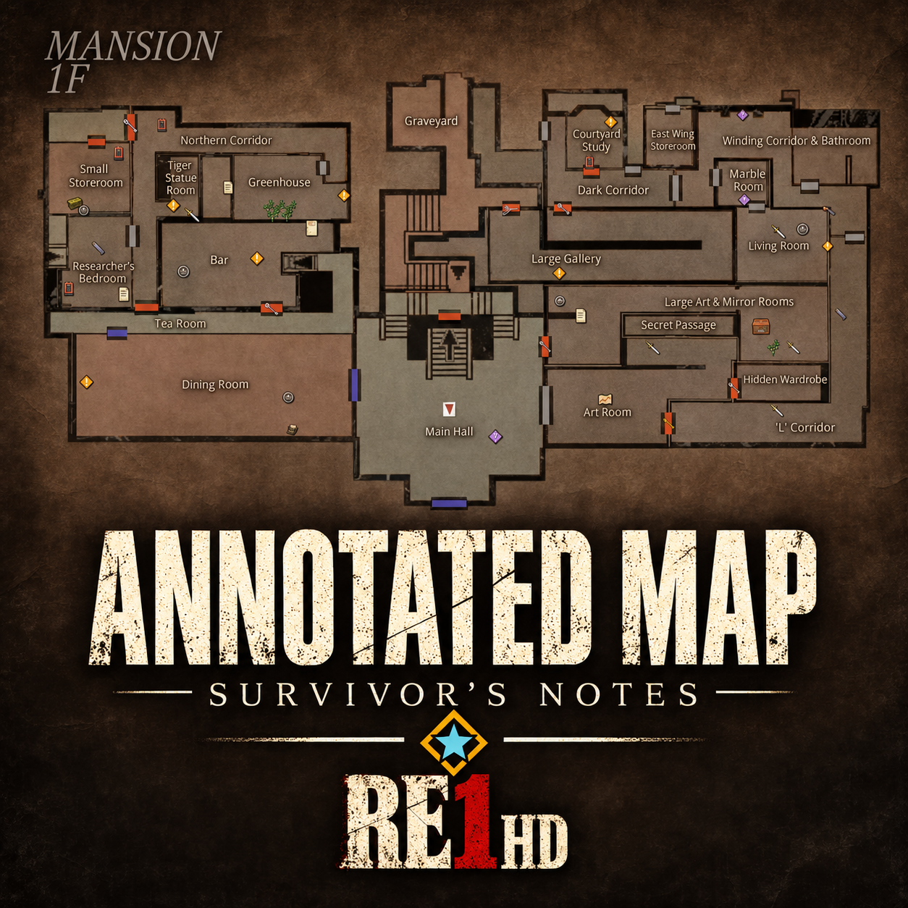
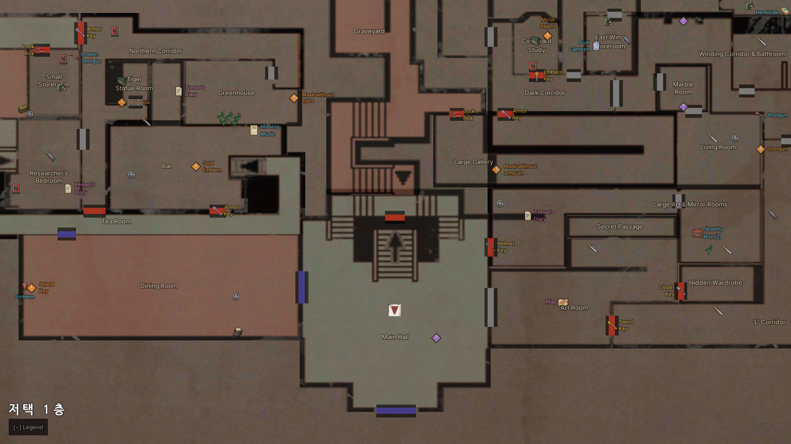
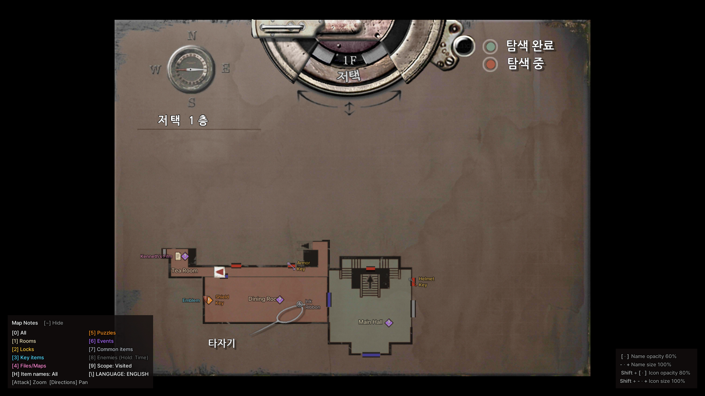
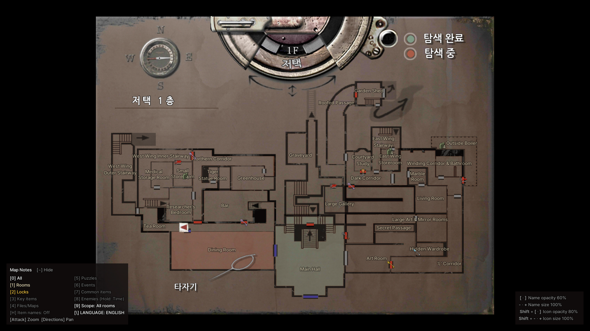
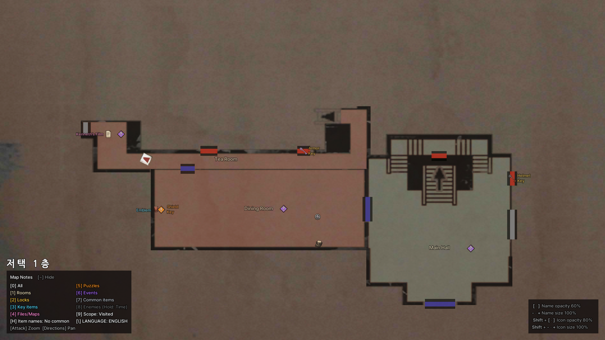
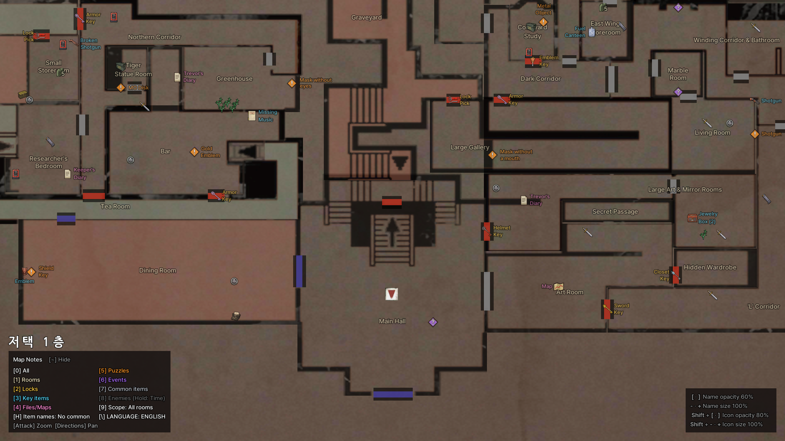
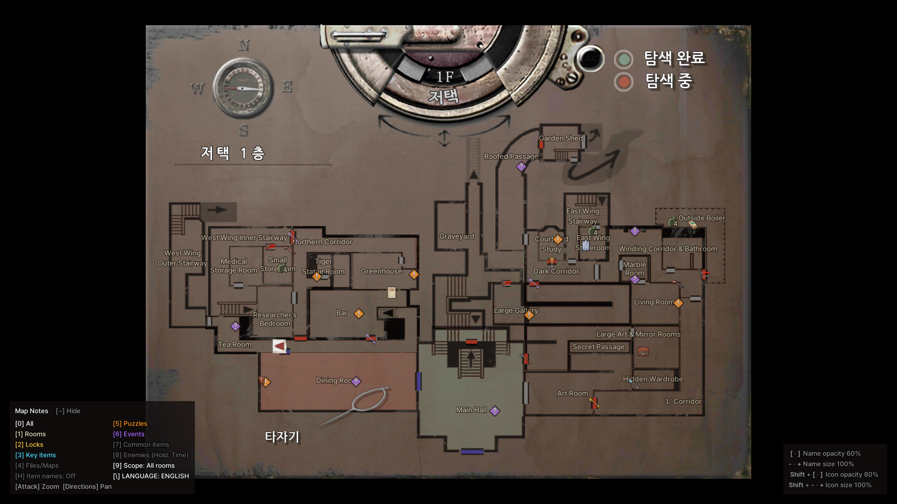

# RE1 HD Annotated Map - Survivor's Notes — Resident Evil HD REMASTER

[English](README.md) | 한국어

<!-- TODO: add docs/logo.png (320 px wide), then uncomment:

-->

**상세 지도: 생존자의 메모** — Steam·GOG판 Resident Evil / Biohazard HD REMASTER의 지도에 방 이름, 잠긴 문과 열쇠, 아이템, 문서·지도, 퍼즐, 이벤트, 타자기·아이템 상자, 적을 표시하는 ASI 모드입니다. 한국어/영어를 지원합니다. 1996년 원작용이 아닙니다. 원작용은 [RE1 Annotated Map](https://github.com/eggu/resident-evil-annotated-map)을 쓰세요.

- 게임 자체의 지도 화면에 표시합니다. 주운 아이템, 완료한 퍼즐은 지도에서 사라집니다.
- 방문한 방만 보거나, 지도로 공개된 방 또는 모든 방을 볼 수 있습니다.
- 지도를 2배로 확대하고 움직일 수 있습니다.
- 아이템과 적을 아이콘으로 표시합니다. 크림슨 헤드는 부활 전까지 회색으로 표시하며, 남은 시간도 볼 수 있습니다.

## 스크린샷

<!-- TODO: 작성자가 준비한 파일을 docs/screenshots/에 추가 -->

| | 방문한 방 | 모든 방 |
|---|---|---|
| 축소 |  |  |
| 2배 확대 |  |  |

## 표시 범위와 기본값

Steam 또는 GOG판 Resident Evil / Biohazard HD REMASTER(`bhd.exe`, 현재 빌드)가 필요합니다.

처음 실행하면 영어, 방문한 방, 방 이름만 표시합니다. 나머지는 지도 화면에서 숫자 키로 켭니다. 이벤트(스포일러)도 처음에는 숨겨져 있습니다.

## 설치

1. 게임을 종료합니다. [Releases](https://github.com/eggu/resident-evil-hd-annotated-map/releases/latest)에서 `RE1-HD-Annotated-Map-<버전>.zip`을 받아 압축을 풉니다. `Source code`는 설치 파일이 아닙니다.
2. ZIP의 내용(`dinput8.dll`, `scripts/`)을 `bhd.exe`가 있는 게임 폴더에 폴더 구조 그대로 복사합니다. Steam은 라이브러리에서 게임을 오른쪽 클릭한 뒤 **관리 → 로컬 파일 보기**, GOG Galaxy는 게임 페이지에서 **설정(⚙) → 설치 관리 → 폴더 보기**를 누르면 이 폴더가 열립니다.
   - ASI 로더인 [Ultimate ASI Loader](https://github.com/ThirteenAG/Ultimate-ASI-Loader) v9.7.4(MIT)가 `dinput8.dll`로 포함되어 있습니다.
   - Fusion Fix 등으로 `dinput8.dll`이 이미 있으면 `dinput8.dll`은 건너뛰고 `scripts/`만 복사하세요.
3. 게임을 실행하고 지도를 엽니다.

업그레이드할 때는 `scripts/RE1HD.AnnotatedMap.ini`를 건너뛰거나 백업 후 복원하세요.

제거: `scripts/`의 `RE1HD.AnnotatedMap`으로 시작하는 파일을 지웁니다. 다른 ASI 모드가 없으면 `dinput8.dll`도 지웁니다. EXE와 세이브는 수정하지 않습니다. 지원 대상이 아닌 실행 파일에서는 아무것도 패치하지 않고 로그만 남깁니다.

## 단축키

지도 화면에서만 작동하며, 현재 상태가 범례에 표시됩니다.

| 키 | 동작 |
|---|---|
| 0 | 전체 표시 켜기/끄기 |
| 1 | 방 이름 |
| 2 | 잠긴 문·필요한 열쇠 |
| 3 | 핵심 아이템 |
| 4 | 문서·지도 |
| 5 | 퍼즐 |
| 6 | 이벤트 (스포일러가 되는 이야기 장면) |
| 7 | 일반 아이템 |
| 8 | 적·크림슨 헤드 (적 표시 중 길게 누르면 부활까지 남은 시간 켜기/끄기) |
| 9 | 방문한 방 → 공개된 방 → 모든 방 |
| \(₩) | 한국어 / English |
| - · + (숫자패드 포함) | 이름 크기 10%씩(50–150%) |
| [ · ] | 이름 불투명도 10%씩(10–100%) |
| Shift + - · + | 아이콘 크기 10%씩(50–200%) |
| Shift + [ · ] | 아이콘 불투명도 10%씩(10–100%) |
| H | 아이템 이름 3단계: 모두 → 일반 아이템 제외 → 끔 (처음에는 끔) |
| ~ | 범례 접기/펴기 (오른쪽 아래 설정 값도 함께) |
| 공격 버튼 | 지도 2배 확대·축소 |
| 방향 입력(확대 중) | 지도 이동 |

지도를 다시 열면 1배로 돌아옵니다.

## 설정

지도 화면에서 바꾼 설정은 자동으로 저장됩니다. 설정 파일은 `scripts/RE1HD.AnnotatedMap.ini`입니다. 직접 편집하려면 게임을 종료한 뒤 메모장으로 여세요.

- `Modifier=Ctrl`: 아이콘 크기·불투명도 키를 Shift 대신 Ctrl과 함께 누릅니다.
- `DoorKey=Unvisited`: 잠긴 문의 열쇠를 문 가운데 대신 아직 가 보지 않은 쪽 방에 표시합니다.
- `[Colors]`: 분류별 색을 `#RRGGBB`로 바꿉니다. 항목: `Rooms`, `Locks`, `KeyItems`, `Files`, `Puzzles`, `Events`, `CommonItems`, `Enemies`. 없는 항목은 기본색입니다. 예: `CommonItems=#B8BCC4`. 설정을 저장해도 `[Colors]`와 주석은 그대로 남습니다.

## 표시 안내

- 이벤트(스포일러)는 장면이 시작되는 위치를 알면 그 자리에 표시합니다. 모르면 방마다 표시 하나를 방 이름 옆에 두며, 그 방의 장면을 모두 보면 사라집니다.
- 적은 직접 들어가 본 방에서 기록한 위치만 표시합니다. 한 번도 들어가지 않은 방에는 표시되지 않습니다.
- 모든 방 범위에서도 층과 구역은 게임 기본 조건을 따르므로, 아직 갈 수 없는 지도로는 넘어가지 않습니다.
- 화면 배치는 1440p 기준으로 맞췄습니다. 해상도에 따라 이름이 겹칠 수 있습니다.
- 확대 중에는 게임 기본 안내 UI를 숨기고 모든 타자기·아이템 상자를 방 안 실제 위치에 아이콘으로 표시합니다. 축소 중에는 게임 지도에 표시되지 않는 것만 그립니다.
- 퍼즐은 주황색 `!` 마름모, 이벤트는 이름 없이 보라색 `?` 마름모만 표시합니다(장면을 본 뒤 사라짐). 두 줄 이름은 아이콘 쪽으로 정렬합니다.
- 무기는 핵심 아이템([3])으로 표시합니다. 잠긴 문의 열쇠는 문 가운데에 표시합니다.
- 핵심 아이템이나 퍼즐 표시와 겹친 일반 아이템·적 아이콘은 숨기고, 이름은 가장 덜 겹치는 자리에 표시합니다.

## 위키와 지원

[한국어 위키](docs/wiki/README.md) · [English wiki](docs/wiki/README.en.md): 방, 잠금·열쇠, 아이템, 퍼즐·이벤트, 문서·지도, 세이브 지점과 적. 표에는 스포일러가 있습니다.

문제를 알릴 때는 어느 장소에서 어떤 표시가 잘못됐는지 스크린샷과 함께 설명해 주세요.

## 빌드

소스에서 직접 빌드하려면 [개발 안내](docs/DEVELOPMENT.md)를 참고하세요.

## 다른 지도 모드

- [RE1 Annotated Map - Survivor's Notes](https://github.com/eggu/resident-evil-annotated-map) — 바이오하자드 1 (1996)
- [RE2 Annotated Map - Survivor's Notes](https://github.com/eggu/resident-evil-2-annotated-map) — 바이오하자드 2 (1998)
- [RE3 Annotated Map - Survivor's Notes](https://github.com/eggu/resident-evil-3-annotated-map) — 바이오하자드 3 (1999)

## 크레딧과 권리

제작: **커트씨**. 비공식 팬 모드이며 Capcom과 관련이 없습니다. 소스 코드는 [MIT 라이선스](LICENSE)입니다. 참고 자료와 글꼴 출처는 [NOTICE](NOTICE.md)에 있습니다.
