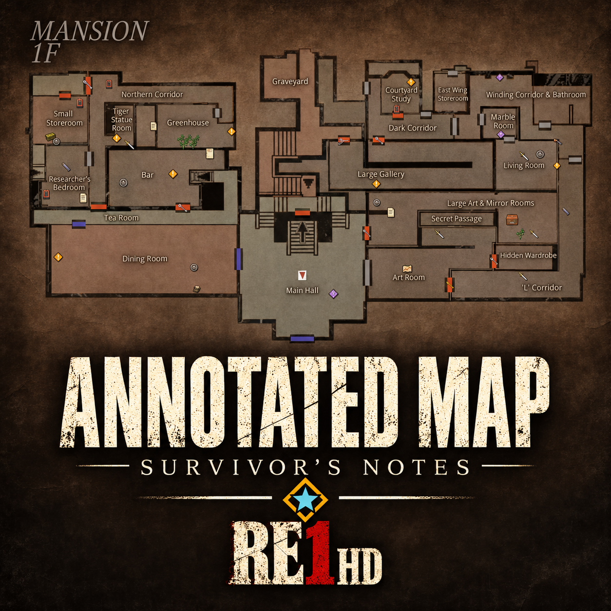
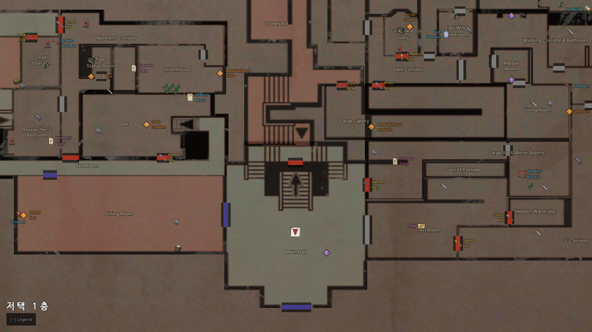
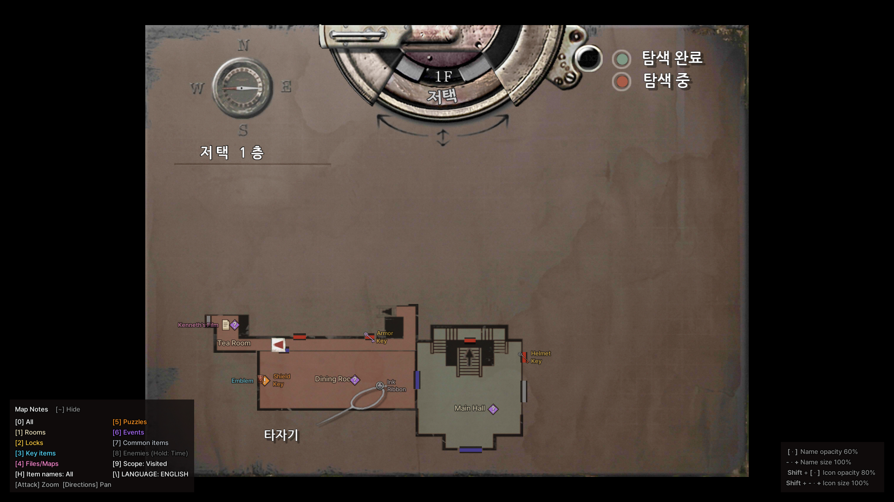
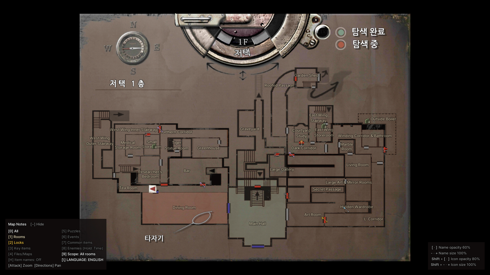
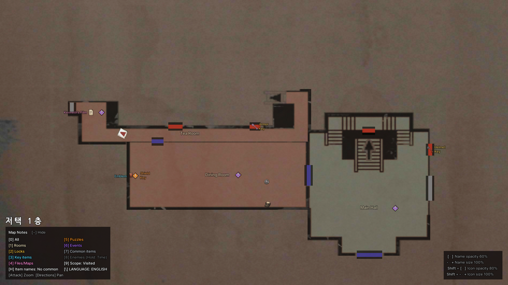
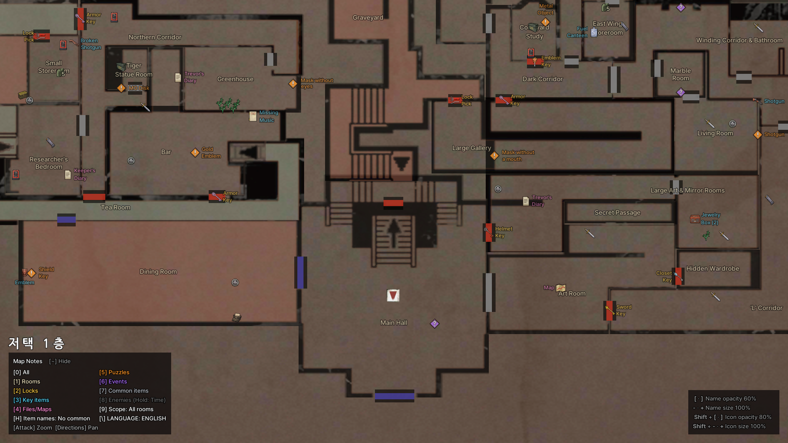
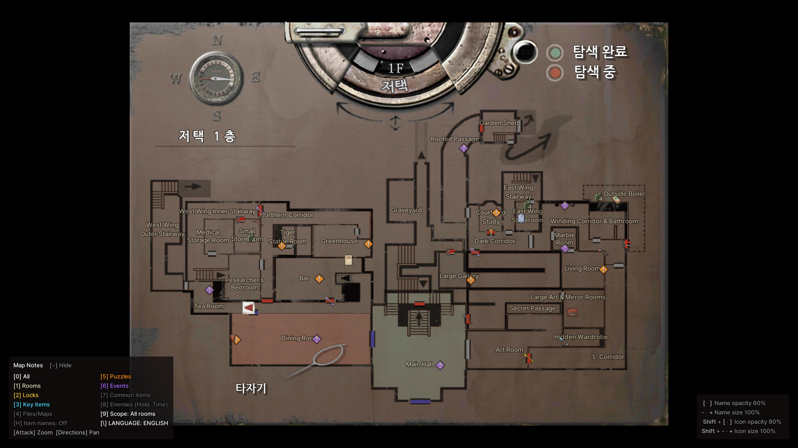

# RE1 HD Annotated Map - Survivor's Notes — Resident Evil HD REMASTER

English | [한국어](README.ko.md)

<!-- TODO: add docs/logo.png (320 px wide), then uncomment:

-->

An ASI mod that shows room names, locked doors and keys, items, documents and maps, puzzles, events, typewriters and item boxes, and enemies on the map of Resident Evil / Biohazard HD REMASTER on Steam. English and Korean are supported. It is not for the 1996 original; use [RE1 Annotated Map](https://github.com/eggu/resident-evil-annotated-map) for that.

- It draws on the game's own map screen. Items you picked up and puzzles you finished disappear from the map.
- Show visited rooms only, rooms revealed by a map, or all rooms.
- Zoom the map 2x and move around it.
- Items and enemies use icons. Crimson Heads stay grey until they can revive, and you can show the time left.

## Screenshots

<!-- TODO: add these files (supplied by the author) to docs/screenshots/ -->

| | Visited rooms | All rooms |
|---|---|---|
| Zoomed out |  |  |
| Zoomed in 2x |  |  |

## Scope and defaults

Requires the Steam or GOG version of Resident Evil / Biohazard HD REMASTER (`bhd.exe`, current build).

The first run uses English, visited rooms and room names only. Turn on the rest with the number keys on the map screen. Events (spoilers) are hidden at first too.

## Installation

1. Close the game. Download `RE1-HD-Annotated-Map-<version>.zip` from [Releases](https://github.com/eggu/resident-evil-hd-annotated-map/releases/latest) and extract it. `Source code` is not the installer.
2. Copy the ZIP contents (`dinput8.dll`, `scripts/`) into the folder with `bhd.exe`, keeping the folder structure. On Steam, right-click the game in your library and choose **Manage → Browse local files**; in GOG Galaxy, open the game, then **Settings (⚙) → Manage installation → Show folder**.
   - [Ultimate ASI Loader](https://github.com/ThirteenAG/Ultimate-ASI-Loader) v9.7.4 (MIT) is included as `dinput8.dll`.
   - If you already have a `dinput8.dll`, for example from Fusion Fix, skip it and copy `scripts/` only.
3. Launch the game and open the map.

When upgrading, skip `scripts/RE1HD.AnnotatedMap.ini` or back it up and restore it.

To uninstall, delete the files in `scripts/` that start with `RE1HD.AnnotatedMap`. If you have no other ASI mods, delete `dinput8.dll` too. The EXE and saves are not modified. On an unsupported executable nothing is patched and only a log is written.

## Keys

The keys work on the map screen only, and the legend shows the current state.

| Key | Action |
|---|---|
| 0 | All annotations on/off |
| 1 | Room names |
| 2 | Locked doors and required keys |
| 3 | Key items |
| 4 | Files and maps |
| 5 | Puzzles |
| 6 | Events (spoiler story scenes) |
| 7 | Common items |
| 8 | Enemies and Crimson Heads (hold while enemies are on: time left until revival on/off) |
| 9 | Visited rooms → revealed rooms → all rooms |
| \ (₩) | Korean / English |
| - · + (numpad too) | Name size in 10% steps (50–150%) |
| [ · ] | Name opacity in 10% steps (10–100%) |
| Shift + - · + | Icon size in 10% steps (50–200%) |
| Shift + [ · ] | Icon opacity in 10% steps (10–100%) |
| H | Item names, 3 states: all → all except common items → off (off at first) |
| ~ | Fold or unfold the legend (and the settings at the bottom right) |
| Attack button | Map zoom 2x on/off |
| Directions (while zoomed) | Move the map |

Reopening the map returns to 1x.

## Settings

Settings changed on the map screen are saved automatically in `scripts/RE1HD.AnnotatedMap.ini`. To edit it by hand, close the game and open it in Notepad.

- `Modifier=Ctrl`: use Ctrl instead of Shift with the icon size and opacity keys.
- `DoorKey=Unvisited`: show a locked door's key in the room you have not visited yet instead of on the door.
- `[Colors]`: change a category's colour as `#RRGGBB`. Keys: `Rooms`, `Locks`, `KeyItems`, `Files`, `Puzzles`, `Events`, `CommonItems`, `Enemies`. A missing key keeps the default, for example `CommonItems=#B8BCC4`. Saving settings keeps `[Colors]` and your comments.

## Notes

- Events (spoilers) are marked where the scene starts when that spot is known. Otherwise one marker per room sits beside the room name; it disappears once all of that room's scenes have played.
- Enemies appear only where they were recorded in rooms you entered. Rooms you never entered show none.
- Even with all rooms shown, floors and areas follow the game's own conditions, so you cannot switch to a map you have not reached.
- The layout was tuned at 1440p. Names can overlap at other resolutions.
- While zoomed, the game's own guide UI is hidden and every typewriter and item box is drawn as an icon at its spot in the room. Zoomed out, only those the game's map does not already mark are drawn.
- Puzzles are an orange `!` diamond, events a purple `?` diamond with no name (gone once the scene has played). Two-line names are aligned toward the icon.
- Weapons are shown as key items ([3]). A locked door's key is shown on the door.
- Common item and enemy icons on a key item or puzzle mark are hidden, and names go where they cover the least.

## Wiki and support

[English wiki](docs/wiki/README.en.md) · [한국어 위키](docs/wiki/README.md): rooms, locks and keys, items, puzzles and events, files and maps, save points and enemies. The tables contain spoilers.

When reporting a problem, tell me where and which marker is wrong, with a screenshot.

## Build

See the [development guide](docs/DEVELOPMENT.md) to build from source.

## Other map mods

- [RE1 Annotated Map - Survivor's Notes](https://github.com/eggu/resident-evil-annotated-map) — Resident Evil (1996)
- [RE2 Annotated Map - Survivor's Notes](https://github.com/eggu/resident-evil-2-annotated-map) — Resident Evil 2 (1998)
- [RE3 Annotated Map - Survivor's Notes](https://github.com/eggu/resident-evil-3-annotated-map) — Resident Evil 3 (1999)

## Credits and rights

Created by **커트씨**. Unofficial fan mod, not affiliated with Capcom. Source code is under the [MIT License](LICENSE). References and font credits are in [NOTICE](NOTICE.md).
