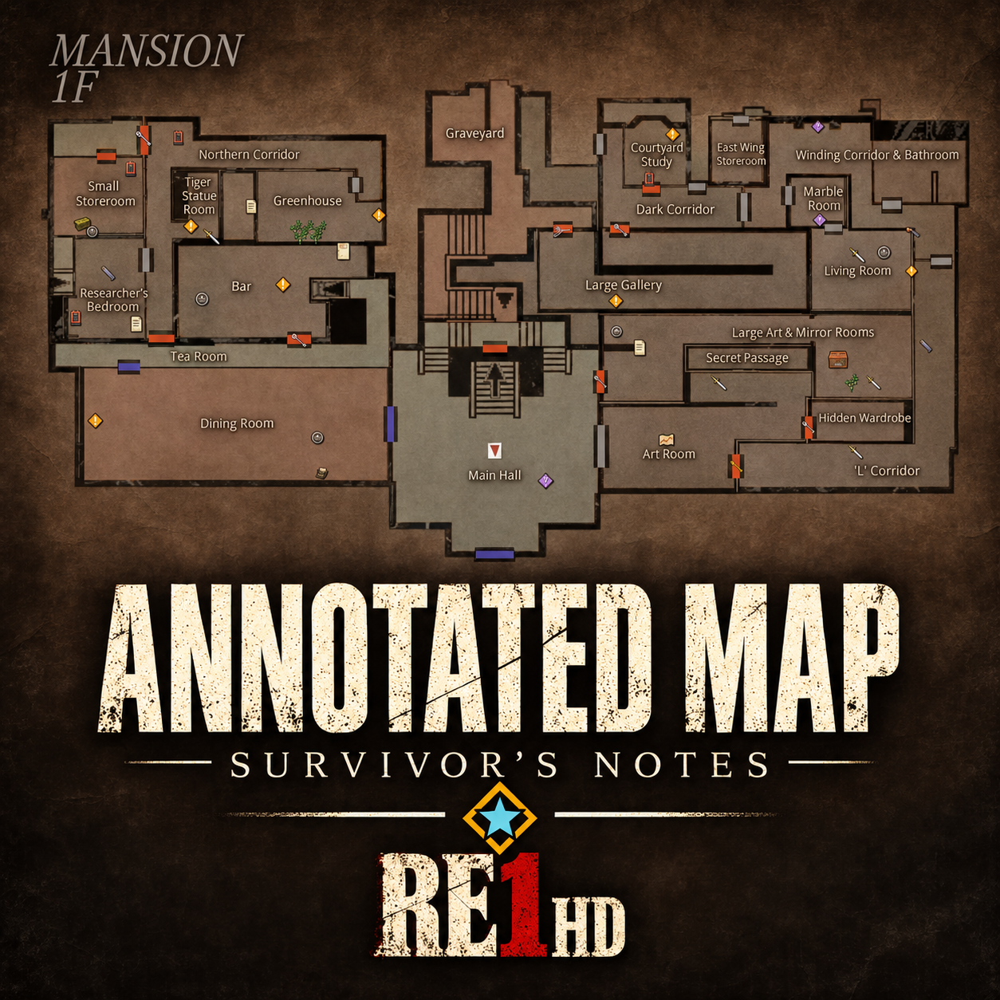
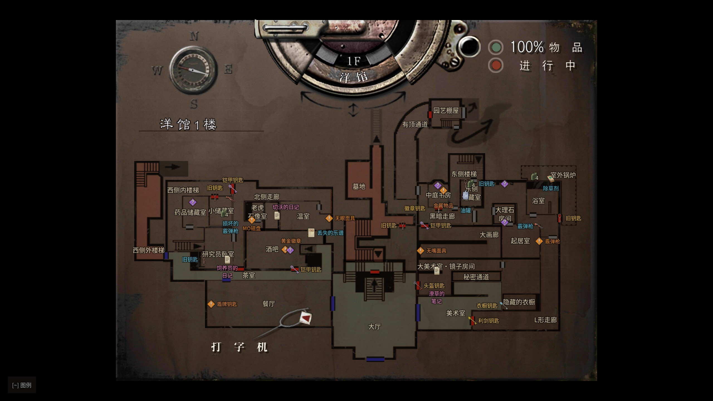
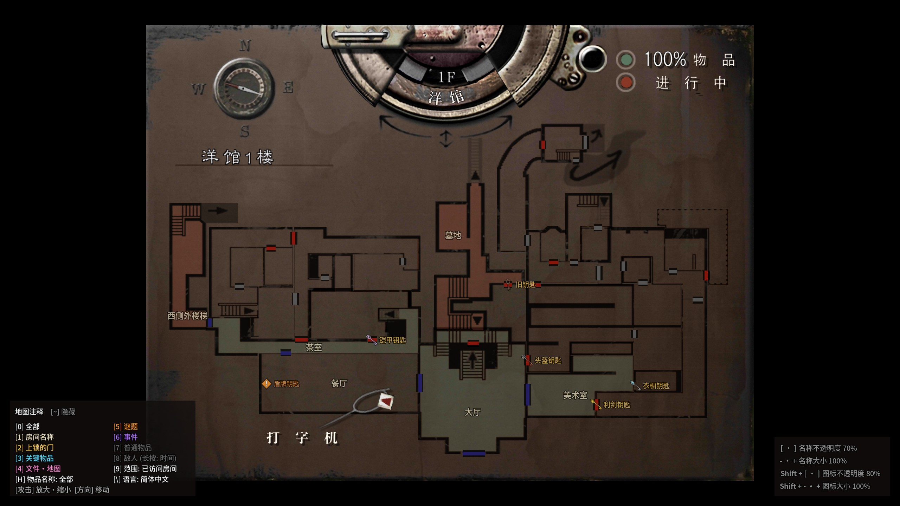
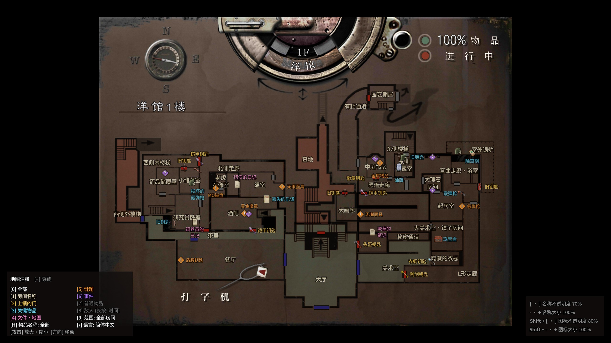
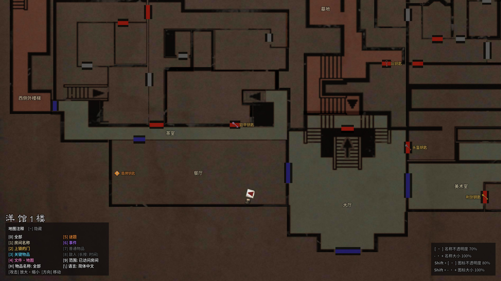
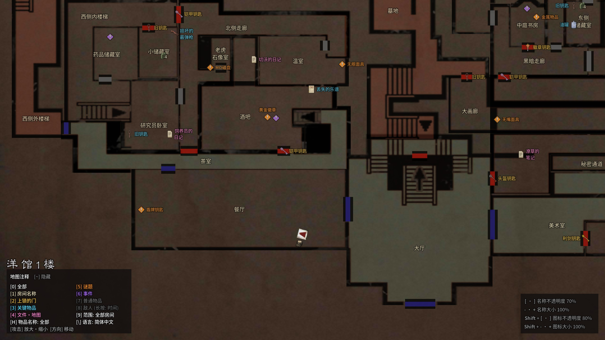

# RE1 HD 详细地图：幸存者笔记（简体中文补充版）

[English](README.md) | [한국어](README.ko.md) | 简体中文

《生化危机 HD 重制版》（Resident Evil / Biohazard HD REMASTER，Steam 或 GOG 版）的 ASI 模组：在游戏自带的地图画面上标注房间名称、上锁的门与所需钥匙、关键物品、文件·地图、谜题、事件、打字机·物品箱和敌人。原作支持英语和韩语；本补充版加入了**简体中文（zh_cn）**作为第三语言槽位。不适用于 1996 年原版。

- 直接画在游戏的地图画面上。已拾取的物品、已完成的谜题会从地图上消失。
- 可只显示已访问的房间、地图揭示的房间或全部房间。
- 地图可放大 2 倍并移动。
- 物品和敌人以图标显示。赤红头在可以复活前显示为灰色，并可显示剩余时间。

## 截图

| | 已访问的房间 | 全部房间 |
|---|---|---|
| 缩小 |  |  |
| 放大 2 倍 |  |  |

## 关于中文

- 房间名称、门锁钥匙、关键物品、文件、谜题、普通物品名称以及图例全部为简体中文，使用**思源黑体**（Source Han Sans SC，SIL OFL 1.1）渲染成位图嵌入模组，运行时不需要安装字体。
- 物品、钥匙、文件与地点名称与常用的**扑家汉化**补丁保持一致（例如 利剑钥匙、供电区的钥匙、风之饰章、大水槽、影像资料室、切沃的日记），配合该补丁游玩时与游戏内文字对应。扑家汉化补丁修改的是游戏的 `nativePC` 资源，本模组只放在 `scripts/` 和 `dinput8.dll`，两者可同时安装、互不覆盖。
- 房间名称按中文宽度重新排布，并通过与原版相同的“不重叠、锚点在房间内”检查。
- 中文是兼容性的第三槽位：沿用韩文版的全部位置与显示条件，只替换文字图像。

## 安装

1. 关闭游戏。解压 `RE1-HD-Annotated-Map-<版本>.zip`。
2. 将 ZIP 内容（`dinput8.dll`、`scripts/`）按目录结构复制到 `bhd.exe` 所在的文件夹。Steam：库中右键游戏 → **管理 → 浏览本地文件**；GOG Galaxy：游戏 → **设置(⚙) → 管理安装 → 显示文件夹**。
   - 已附带 [Ultimate ASI Loader](https://github.com/ThirteenAG/Ultimate-ASI-Loader) v9.7.4（MIT），文件名为 `dinput8.dll`。
   - 如果已有 `dinput8.dll`（例如 Fusion Fix 的），跳过它，只复制 `scripts/`。
3. 启动游戏并打开地图。

首次运行为英语：在地图画面按 `\`（English → 한국어 → 简体中文）切换到中文，设置会自动保存；也可以把 `scripts/RE1HD.AnnotatedMap.ini` 中的 `Language` 改为 `zh`。

卸载：删除 `scripts/` 中以 `RE1HD.AnnotatedMap` 开头的文件；如果没有其他 ASI 模组，也删除 `dinput8.dll`。不修改 EXE 和存档。

## 按键（仅在地图画面有效）

| 按键 | 作用 |
|---|---|
| 0 | 全部标注开/关 |
| 1 | 房间名称 |
| 2 | 上锁的门与所需钥匙 |
| 3 | 关键物品 |
| 4 | 文件与地图 |
| 5 | 谜题 |
| 6 | 事件（剧透的剧情场景） |
| 7 | 普通物品 |
| 8 | 敌人与赤红头（显示敌人时长按：复活剩余时间开/关，单位 m） |
| 9 | 已访问房间 → 已揭示房间 → 全部房间 |
| \ (₩) | 语言：English → 한국어 → 简体中文 |
| - · +（含小键盘） | 名称大小，每次 10%（50–150%） |
| [ · ] | 名称不透明度，每次 10%（10–100%） |
| Shift + - · + | 图标大小，每次 10%（50–200%） |
| Shift + [ · ] | 图标不透明度，每次 10%（10–100%） |
| H | 物品名称：全部 → 不含普通物品 → 关（初始为关） |
| ~ | 折叠/展开图例 |
| 攻击键 | 地图 2 倍放大开/关 |
| 方向（放大时） | 移动地图 |

## 设置

地图画面上改变的设置会自动保存到 `scripts/RE1HD.AnnotatedMap.ini`。手动编辑时请先关闭游戏。

- `Language=zh`：简体中文（`en` 英语，`ko` 韩语）。
- `Modifier=Ctrl`：图标大小与不透明度改用 Ctrl。
- `DoorKey=Unvisited`：上锁的门的钥匙显示在尚未访问的一侧房间，而不是门上。
- `[Colors]`：用 `#RRGGBB` 修改各分类颜色（`Rooms`、`Locks`、`KeyItems`、`Files`、`Puzzles`、`Events`、`CommonItems`、`Enemies`）。

## 构建

见[开发指南](docs/DEVELOPMENT.md)（含 “Simplified Chinese (zh_cn)” 一节）。需要 Python 3.11 及以上。

## 致谢与权利

原作者 **커트씨**（[eggu/resident-evil-hd-annotated-map](https://github.com/eggu/resident-evil-hd-annotated-map)）。非官方粉丝模组，与 Capcom 无关。源代码采用 [MIT 许可](LICENSE)。中文字体为思源黑体（Adobe，SIL OFL 1.1）；参考资料与字体出处见 [NOTICE](NOTICE.md)。
