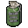
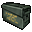
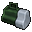

# Common items

[한국어](08-common-items.md) | [English](08-common-items.en.md) · [Index](README.en.md)

Spoilers. Rows are conditional variants from current src/labels.h, not unique item counts or simultaneous spawns. Additional runtime gates apply; see the notes and [Data and table notation](02-data-pipeline.en.md).

Item names follow Evil Resource. One location can have several rows with different conditions.

| Map | Room ID | Room | Physical room | Item | Icon | x,y | Character | Difficulty | Condition | flag |
| --- | --- | --- | --- | --- | --- | --- | --- | --- | --- | --- |
| 0:2 | 102 | Small Storeroom | — | Flash Grenade |  | 245.1,360.9 | Chris | — | — | 76 |
| 0:2 | 102 | Small Storeroom | — | Ink Ribbon |  | 217.74,405.54 | — | — | — | 67 |
| 0:2 | 102 | Small Storeroom | — | Battery Pack |  | 245.1,360.9 | Jill | — | — | 66 |
| 0:2 | 103 | Northern Corridor | — | Battery Pack |  | 286.5,338.4 | Jill | Very Easy/Easy, Normal | conditional | 32 |
| 0:2 | 103 | Northern Corridor | — | Flash Grenade |  | 286.5,338.4 | Chris | Very Easy/Easy, Normal | conditional | 31 |
| 0:2 | 103 | Northern Corridor | — | Dagger |  | 311.7,411.3 | — | Very Easy/Easy | conditional | 16 |
| 0:2 | 105 | Dining Room | — | Ink Ribbon |  | 384.6,553.5 | — | — | — | 177 |
| 0:2 | 107 | Art Room | — | Dagger |  | 672.6,513.9 | — | — | — | 82 |
| 0:2 | 108 | 'L' Corridor | — | Handgun Magazine |  | 818.4,486.9 | — | Very Easy/Easy, Normal | — | 192 |
| 0:2 | 108 | 'L' Corridor | — | Dagger |  | 774.3,565.2 | — | — | — | 193 |
| 0:2 | 113 | Bathroom | 109 Winding Corridor | Dagger |  | 813.9,347.4 | — | — | — | 108 |
| 0:2 | 10b | Graveyard | — | Shotgun Shells |  | 465.84,280.16 | — | — | — | 462 |
| 0:3 | 201 | Crypt | 10b Graveyard | Shotgun Shells |  | 603.3,280.8 | — | Very Easy/Easy, Normal | After all four masks are inserted (bank 1 flags 50–53) | 463 |
| 0:3 | 201 | Crypt | 10b Graveyard | Handgun Magazine |  | 603.3,280.8 | — | Hard | After all four masks are inserted (bank 1 flags 50–53) | 463 |
| 0:2 | 10c | Greenhouse | — | Green Herb |  | 372,407.7 | — | — | conditional | 194 |
| 0:2 | 10c | Greenhouse | — | Green Herb |  | 379.2,407.7 | — | — | conditional | 195 |
| 0:2 | 10c | Greenhouse | — | Green Herb |  | 385.5,408.6 | — | — | conditional | 196 |
| 0:2 | 10c | Greenhouse | — | Green Herb |  | 382.8,412.2 | — | — | conditional | 197 |
| 0:2 | 10c | Greenhouse | — | Green Herb |  | 374.7,412.2 | — | — | conditional | 198 |
| 0:2 | 10d | Tiger Statue Room | — | Shotgun Shells |  | 291.9,378.9 | — | — | — | 321 |
| 0:2 | 10e | Researcher's Bedroom | — | Handgun Magazine |  | 234.3,440.1 | — | — | — | 330 |
| 0:2 | 10e | Researcher's Bedroom | — | Battery Pack |  | 206.4,466.2 | Jill | — | — | 367 |
| 0:2 | 10f | Bar | — | Ink Ribbon |  | 300,454.5 | — | Very Easy/Easy | — | 178 |
| 0:2 | 11d | Mirror Room | 111 Large Art & Mirror Rooms | Dagger |  | 780.6,517.5 | — | — | — | 200 |
| 0:2 | 11d | Mirror Room | 111 Large Art & Mirror Rooms | Green Herb |  | 766.2,517.5 | — | — | — | 202 |
| 0:2 | 111 | Large Art & Mirror Rooms | — | Ink Ribbon |  | 601.5,476.1 | — | — | — | 201 |
| 0:2 | 112 | West Wing Outer Stairway | — | Handgun Magazine |  | 90.3,373.5 | — | Very Easy/Easy, Normal | — | 349 |
| 0:2 | 112 | West Wing Outer Stairway | — | Green Herb |  | 112.8,324 | — | Very Easy/Easy, Normal | — | 350 |
| 0:2 | 112 | West Wing Outer Stairway | — | Green Herb |  | 116.4,324 | — | — | — | 351 |
| 0:2 | 114 | Outside Boiler | — | Green Herb |  | 808.5,316.8 | — | — | — | 179 |
| 0:2 | 114 | Outside Boiler | — | Green Herb |  | 819.3,316.8 | — | — | — | 180 |
| 0:2 | 114 | Outside Boiler | — | Red Herb |  | 781.5,308.7 | — | — | — | 181 |
| 0:2 | 114 | Outside Boiler | — | Red Herb |  | 781.5,315.9 | — | Very Easy/Easy | — | 182 |
| 0:2 | 114 | Outside Boiler | — | Red Herb |  | 788.7,315.9 | — | Very Easy/Easy | — | 183 |
| 0:2 | 116 | Living Room | — | Dagger |  | 769.8,424.8 | — | — | conditional (Jill) | 209 |
| 0:2 | 116 | Living Room | — | Ink Ribbon |  | 788.7,424.8 | — | Very Easy/Easy, Normal | conditional (Jill) | 211 |
| 0:2 | 118 | East Wing Storeroom | — | Handgun Magazine |  | 700.5,345.6 | — | Very Easy/Easy | — | 71 |
| 0:2 | 118 | East Wing Storeroom | — | Handgun Magazine |  | 687.9,345.6 | — | Very Easy/Easy | conditional | 88 |
| 0:2 | 118 | East Wing Storeroom | — | Handgun Magazine |  | 682.5,349.2 | — | Very Easy/Easy | conditional | 92 |
| 0:2 | 118 | East Wing Storeroom | — | Shotgun Shells |  | 682.5,353.7 | Chris | Very Easy/Easy | conditional | 89 |
| 0:2 | 118 | East Wing Storeroom | — | Incendiary Shells |  | 682.5,353.7 | Jill | Very Easy/Easy | conditional | 89 |
| 0:2 | 118 | East Wing Storeroom | — | First Aid Spray |  | 689.7,353.7 | — | Very Easy/Easy | conditional | 90 |
| 0:2 | 118 | East Wing Storeroom | — | First Aid Spray |  | 689.7,349.2 | — | Very Easy/Easy | conditional | 93 |
| 0:2 | 118 | East Wing Storeroom | — | Handgun Magazine |  | 682.5,349.2 | Chris | Normal | conditional | 92 |
| 0:2 | 118 | East Wing Storeroom | — | Shotgun Shells |  | 682.5,353.7 | Chris | Normal | conditional | 89 |
| 0:2 | 118 | East Wing Storeroom | — | Incendiary Shells |  | 682.5,353.7 | Jill | Normal | conditional | 89 |
| 0:2 | 118 | East Wing Storeroom | — | Handgun Magazine |  | 682.5,349.2 | — | Hard | conditional | 92 |
| 0:2 | 118 | East Wing Storeroom | — | First Aid Spray |  | 689.7,353.7 | — | Normal, Hard | conditional | 90 |
| 0:2 | 119 | Courtyard Study | — | Flash Grenade |  | 624.9,367.2 | Chris | — | — | 185 |
| 0:2 | 119 | Courtyard Study | — | Shotgun Shells |  | 626.7,346.5 | — | — | — | 184 |
| 0:2 | 119 | Courtyard Study | — | Battery Pack |  | 624.9,367.2 | Jill | — | — | 185 |
| 0:2 | 11b | Garden Shed | — | Flash Grenade |  | 625.8,226.8 | Chris | — | — | 78 |
| 0:2 | 11b | Garden Shed | — | Shotgun Shells |  | 625.8,187.2 | — | — | — | 79 |
| 0:2 | 11b | Garden Shed | — | First Aid Spray |  | 645.6,225 | — | — | — | 80 |
| 0:2 | 11b | Garden Shed | — | Flash Grenade |  | 633.9,196.2 | Chris | Very Easy/Easy | conditional | 119 |
| 0:2 | 11b | Garden Shed | — | Battery Pack |  | 633.9,196.2 | Jill | Very Easy/Easy | conditional | 119 |
| 0:2 | 11b | Garden Shed | — | Shotgun Shells |  | 618.6,189 | Chris | Very Easy/Easy | conditional | 120 |
| 0:2 | 11b | Garden Shed | — | Acid Shells |  | 618.6,189 | Jill | Very Easy/Easy | conditional | 120 |
| 0:2 | 11b | Garden Shed | — | First Aid Spray |  | 624.9,195.3 | — | Very Easy/Easy | conditional | 121 |
| 0:2 | 11b | Garden Shed | — | First Aid Spray |  | 633.9,189 | — | Very Easy/Easy | conditional | 122 |
| 0:2 | 11b | Garden Shed | — | Flash Grenade |  | 633.9,196.2 | Chris | Normal | conditional | 119 |
| 0:2 | 11b | Garden Shed | — | Battery Pack |  | 633.9,196.2 | Jill | Normal | conditional | 119 |
| 0:2 | 11b | Garden Shed | — | Grenade Shells |  | 618.6,189 | Jill | Normal | conditional | 120 |
| 0:2 | 11b | Garden Shed | — | Shotgun Shells |  | 618.6,189 | Chris | Normal | conditional | 120 |
| 0:2 | 11b | Garden Shed | — | First Aid Spray |  | 624.9,195.3 | — | Normal | conditional | 121 |
| 0:2 | 11b | Garden Shed | — | Dagger |  | 633.9,196.2 | — | Hard | conditional | 119 |
| 0:2 | 11b | Garden Shed | — | Shotgun Shells |  | 618.6,189 | — | Hard | conditional | 120 |
| 0:2 | 11b | Garden Shed | — | Battery Pack |  | 625.8,226.8 | Jill | — | — | 103 |
| 0:1 | 202 | Dining Room | — | Dagger |  | 329.7,504 | — | Very Easy/Easy, Normal | — | 167 |
| 0:1 | 206 | Small Library | — | Handgun Magazine |  | 639.3,376.2 | — | — | — | 95 |
| 0:2 | 120 | East Wing Stairway | 207 East Wing Stairway | Green Herb |  | 705,300.6 | — | Very Easy/Easy | — | 369 |
| 0:1 | 208 | Deer Room | — | Red Herb |  | 782.88,343.72 | — | — | — | 361 |
| 0:1 | 208 | Deer Room | — | Green Herb |  | 777,343.8 | — | Very Easy/Easy | — | 363 |
| 0:1 | 209 | Bedroom | — | First Aid Box |  | 713.1,375.3 | — | Very Easy/Easy, Normal | — | 186 |
| 0:1 | 209 | Bedroom | — | Ink Ribbon |  | 679.8,342.9 | — | — | — | 187 |
| 0:1 | 209 | Bedroom | — | Green Herb |  | 672.6,372.6 | — | — | — | 188 |
| 0:1 | 20b | Resting Room | — | Green Herb |  | 851.7,396.9 | — | — | — | 331 |
| 0:1 | 20b | Resting Room | — | Red Herb |  | 851.7,391.5 | — | Very Easy/Easy | — | 333 |
| 0:1 | 20b | Resting Room | — | Green Herb |  | 847.2,395.1 | — | Very Easy/Easy | — | 370 |
| 0:1 | 20c | Sliding Trap Room | — | Dagger |  | 784.68,494.11 | — | Normal | — | 33 |
| 0:1 | 20c | Sliding Trap Room | — | Battery Pack |  | 784.68,494.11 | Jill | Very Easy/Easy | — | 33 |
| 0:1 | 20c | Sliding Trap Room | — | Flash Grenade |  | 784.68,494.11 | Chris | Very Easy/Easy | — | 33 |
| 0:1 | 20d | Pillar Room | — | Green Herb |  | 685.2,568.8 | — | — | — | 217 |
| 0:1 | 20d | Pillar Room | — | Green Herb |  | 696,569.7 | — | — | — | 218 |
| 0:1 | 20e | Attic Entry | — | Flash Grenade |  | 779.18,513.02 | Chris | Very Easy/Easy, Normal | — | 94 |
| 0:1 | 20f | Small Dining Room | — | Handgun Magazine |  | 756.3,568.8 | — | Normal | — | 98 |
| 0:1 | 20f | Small Dining Room | — | Shotgun Shells |  | 756.3,568.8 | — | Very Easy/Easy | — | 98 |
| 0:1 | 20f | Small Dining Room | — | Handgun Magazine |  | 738.3,539.1 | — | — | — | 85 |
| 0:1 | 210 | Attic | — | Shotgun Shells |  | 794.1,568.8 | — | Very Easy/Easy | — | 20 |
| 0:1 | 210 | Attic | — | Shotgun Shells |  | 794.1,568.8 | — | Very Easy/Easy, Normal | — | 20 |
| 0:1 | 212 | Outside Patio | — | Dagger |  | 794.1,609.3 | — | — | — | 328 |
| 0:1 | 212 | Outside Patio | — | Green Herb |  | 865.2,506.7 | — | Very Easy/Easy, Normal | — | 326 |
| 0:1 | 212 | Outside Patio | — | Green Herb |  | 872.4,506.7 | — | Very Easy/Easy, Normal | — | 327 |
| 0:1 | 212 | Outside Patio | — | Handgun Magazine |  | 629.4,582.3 | — | Very Easy/Easy | — | 371 |
| 0:1 | 213 | Elevator Corridor | — | Green Herb |  | 395.4,448.2 | — | — | — | 35 |
| 0:1 | 213 | Elevator Corridor | — | Green Herb |  | 395.4,438.3 | — | — | — | 37 |
| 0:1 | 213 | Elevator Corridor | — | Red Herb |  | 409.8,437.4 | — | Very Easy/Easy, Normal | — | 36 |
| 0:1 | 214 | Mirror Corridor | — | Handgun Magazine |  | 241.5,467.1 | — | — | — | 99 |
| 0:1 | 214 | Mirror Corridor | — | Green Herb |  | 214.5,299.7 | — | — | — | 84 |
| 0:1 | 214 | Mirror Corridor | — | Green Herb |  | 208.2,299.7 | — | Very Easy/Easy | — | 115 |
| 0:1 | 215 | Trophy Room | — | Shotgun Shells |  | 183,411.3 | Chris | Very Easy/Easy, Normal | conditional | 191 |
| 0:1 | 215 | Trophy Room | — | Handgun Magazine |  | 183,411.3 | — | Hard | conditional | 191 |
| 0:1 | 215 | Trophy Room | — | Dagger |  | 163.2,347.4 | — | — | conditional | 190 |
| 0:1 | 215 | Trophy Room | — | Grenade Shells |  | 183,411.3 | Jill | Very Easy/Easy, Normal | conditional | 191 |
| 0:1 | 219 | Materials Room | — | Flash Grenade |  | 327.9,496.8 | Chris | — | — | 29 |
| 0:1 | 219 | Materials Room | — | Shotgun Shells |  | 345.9,481.5 | Chris | — | — | 27 |
| 0:1 | 219 | Materials Room | — | Magnum Rounds |  | 350.4,481.5 | Chris | Very Easy/Easy, Hard | — | 28 |
| 0:1 | 219 | Materials Room | — | Shotgun Shells |  | 350.4,481.5 | Chris | Normal | — | 28 |
| 0:1 | 219 | Materials Room | — | Battery Pack |  | 327.9,496.8 | Jill | — | — | 26 |
| 0:1 | 219 | Materials Room | — | Acid Shells |  | 345.9,481.5 | Jill | Very Easy/Easy | — | 24 |
| 0:1 | 219 | Materials Room | — | Shotgun Shells |  | 345.9,481.5 | Jill | Normal, Hard | — | 24 |
| 0:1 | 219 | Materials Room | — | Magnum Rounds |  | 350.4,481.5 | Jill | Very Easy/Easy, Hard | — | 25 |
| 0:1 | 219 | Materials Room | — | Acid Shells |  | 350.4,481.5 | Jill | Normal | — | 25 |
| 0:3 | 21a | Concrete Passage 1 | — | Shotgun Shells |  | 525,495.9 | — | — | — | 220 |
| 0:3 | 21b | Concrete Passage 2 | — | Red Herb |  | 444.9,571.5 | — | Very Easy/Easy, Normal | — | 101 |
| 0:3 | 21b | Concrete Passage 2 | — | Blue Herb |  | 445.8,565.2 | — | — | — | 102 |
| 0:3 | 21b | Concrete Passage 2 | — | Handgun Magazine |  | 322.5,525.6 | — | Very Easy/Easy, Normal | — | 86 |
| 0:3 | 21b | Concrete Passage 2 | — | Dagger |  | 454.81,530.69 | — | — | — | 87 |
| 0:3 | 21c | Kitchen | — | Dagger |  | 334.2,498.6 | — | Very Easy/Easy, Normal | — | 83 |
| 0:3 | 21c | Kitchen | — | Handgun Magazine |  | 363.9,497.7 | — | Very Easy/Easy | — | 97 |
| 1:2 | 302 | Falls Area | — | Green Herb |  | 317.1,541.8 | — | Very Easy/Easy | — | 245 |
| 1:2 | 304 | Zigzag Path | — | Red Herb |  | 241.5,518.4 | — | Very Easy/Easy, Normal | — | 166 |
| 1:3 | 307 | Entrance Passage | — | Ink Ribbon |  | 452.1,278.1 | — | — | — | 125 |
| 1:3 | 307 | Entrance Passage | — | Green Herb |  | 410.7,387.9 | — | — | — | 116 |
| 1:3 | 307 | Entrance Passage | — | Blue Herb |  | 480.9,338.4 | — | Very Easy/Easy | — | 126 |
| 1:3 | 308 | Forked Passage | — | Shotgun Shells |  | 579.9,445.5 | Chris | Very Easy/Easy | — | 221 |
| 1:3 | 308 | Forked Passage | — | Acid Shells |  | 579.9,445.5 | Jill | Very Easy/Easy | — | 221 |
| 1:3 | 30b | Boulder Passage 1 | — | Shotgun Shells |  | 273.9,470.7 | — | Very Easy/Easy, Normal | — | 168 |
| 1:3 | 30b | Boulder Passage 1 | — | Handgun Magazine |  | 274.8,470.7 | — | Hard | — | 168 |
| 1:3 | 30c | Spider Room | — | Survival Knife |  | 399,511.2 | — | — | — | 387 |
| 1:3 | 30d | Straight Passage | — | Blue Herb |  | 510.6,598.5 | — | Very Easy/Easy, Normal | — | 163 |
| 1:3 | 30d | Straight Passage | — | Blue Herb |  | 514.2,588.6 | — | — | — | 164 |
| 1:3 | 30d | Straight Passage | — | Green Herb |  | 503.4,597.6 | — | Very Easy/Easy | — | 165 |
| 1:3 | 30f | Boulder Passage 2 | — | First Aid Box |  | 147,551.7 | — | — | — | 169 |
| 1:2 | 313 | Forest Pathway | — | Green Herb |  | 635.45,273.3 | — | Very Easy/Easy | — | 222 |
| 1:2 | 313 | Forest Pathway | — | Green Herb |  | 635.45,268.24 | — | Very Easy/Easy | — | 223 |
| 1:4 | 317 | Winding Underground | — | Green Herb |  | 513.3,430.2 | — | — | — | 259 |
| 1:4 | 317 | Winding Underground | — | Green Herb |  | 518.7,430.2 | — | Hard | — | 261 |
| 1:4 | 317 | Winding Underground | — | Red Herb |  | 520.5,430.2 | — | Very Easy/Easy, Normal | — | 260 |
| 1:4 | 318 | Underground Storage Room | — | Magnum Rounds |  | 678.9,459.9 | — | Very Easy/Easy, Normal | — | 376 |
| 1:4 | 318 | Underground Storage Room | — | Handgun Magazine |  | 679.8,460.8 | — | — | — | 375 |
| 1:4 | 318 | Underground Storage Room | — | Flash Grenade |  | 678,462.6 | Chris | — | — | 377 |
| 1:4 | 318 | Underground Storage Room | — | Battery Pack |  | 678,462.6 | Jill | — | — | 378 |
| 1:4 | 31d | Lisa's Room | 319 Lisa's Room | Green Herb |  | 596.1,281.7 | — | — | — | 402 |
| 1:4 | 31d | Lisa's Room | 319 Lisa's Room | Blue Herb |  | 598.8,271.8 | — | — | — | 403 |
| 1:4 | 31d | Lisa's Room | 319 Lisa's Room | Dagger |  | 517.8,296.1 | — | Very Easy/Easy | — | 404 |
| 2:2 | 400 | Entry Corridor | — | Blue Herb |  | 144.3,423 | — | Very Easy/Easy, Normal | — | 225 |
| 2:2 | 400 | Entry Corridor | — | Blue Herb |  | 144.3,433.8 | — | — | — | 226 |
| 2:2 | 400 | Entry Corridor | — | Blue Herb |  | 144.3,443.7 | — | Very Easy/Easy, Normal | — | 227 |
| 2:2 | 401 | Room 001 | — | Handgun Magazine |  | 236.1,379.8 | — | Very Easy/Easy, Normal | — | 256 |
| 2:2 | 401 | Room 001 | — | Handgun Magazine |  | 247.78,373.63 | — | Very Easy/Easy | — | 257 |
| 2:2 | 403 | Storeroom | — | Flash Grenade |  | 183.9,498.6 | Chris | — | — | 228 |
| 2:2 | 403 | Storeroom | — | Ink Ribbon |  | 183,505.8 | — | — | — | 229 |
| 2:2 | 403 | Storeroom | — | First Aid Spray |  | 200.1,486 | — | Very Easy/Easy | — | 230 |
| 2:2 | 403 | Storeroom | — | Battery Pack |  | 183.9,498.6 | Jill | — | — | 228 |
| 2:2 | 404 | Rec Room | — | Green Herb |  | 312.6,495.9 | — | — | — | 231 |
| 2:2 | 404 | Rec Room | — | Green Herb |  | 354.9,419.4 | — | Very Easy/Easy, Normal | — | 232 |
| 2:2 | 404 | Rec Room | — | First Aid Box |  | 363.9,321.3 | — | — | — | 233 |
| 2:2 | 404 | Rec Room | — | Shotgun Shells |  | 326.1,355.5 | — | Very Easy/Easy, Normal | — | 234 |
| 2:2 | 408 | Gallery | — | Red Herb |  | 449.4,343.8 | — | Very Easy/Easy | — | 380 |
| 2:2 | 408 | Gallery | — | Red Herb |  | 676.73,538.15 | — | — | — | 379 |
| 2:2 | 408 | Gallery | — | Handgun Magazine |  | 534,502.2 | — | — | — | 381 |
| 2:2 | 40a | Room 003 | — | Ink Ribbon |  | 592.5,498.6 | — | Very Easy/Easy | conditional | 170 |
| 2:2 | 40b | Room 003 Bathroom | — | Dagger |  | 598.8,443.7 | — | Very Easy/Easy | — | 353 |
| 2:3 | 40d | Aqua Ring Entry | — | Green Herb |  | 556.5,257.4 | — | — | — | 389 |
| 2:4 | 415 | Aqua Ring Entry | 40d Aqua Ring Entry | Magnum Rounds |  | 340.5,305.1 | — | Very Easy/Easy, Normal | — | 390 |
| 2:4 | 410 | Aqua Ring Storage | — | Shotgun Shells |  | 461.1,441.9 | — | Very Easy/Easy | — | 382 |
| 2:4 | 410 | Aqua Ring Storage | — | Shotgun Shells |  | 440.4,450 | — | Very Easy/Easy | — | 358 |
| 2:4 | 410 | Aqua Ring Storage | — | Magnum Rounds |  | 487.2,396.9 | — | Hard | — | 359 |
| 2:4 | 410 | Aqua Ring Storage | — | Shotgun Shells |  | 440.4,450 | — | Normal | — | 358 |
| 2:4 | 410 | Aqua Ring Storage | — | Grenade Shells |  | 461.1,441.9 | — | Very Easy/Easy | — | 383 |
| 2:4 | 411 | Control Room | — | First Aid Box |  | 431.4,556.2 | — | Very Easy/Easy, Normal | — | 249 |
| 4:3 | 501 | Passage to Heliport | — | First Aid Box |  | 507,448.2 | — | — | — | 243 |
| 4:3 | 501 | Passage to Heliport | — | First Aid Box |  | 510.6,462.6 | — | Very Easy/Easy | — | 244 |
| 4:3 | 501 | Passage to Heliport | — | Shotgun Shells |  | 522.3,462.6 | — | Very Easy/Easy, Normal | — | 242 |
| 4:4 | 502 | Item Box Room | — | Ink Ribbon |  | 645.6,388.8 | — | — | — | 258 |
| 4:4 | 503 | Stairway | — | Green Herb |  | 409.8,396 | — | — | — | 395 |
| 4:4 | 503 | Stairway | — | Green Herb |  | 429.6,445.5 | — | Very Easy/Easy, Normal | — | 396 |
| 4:4 | 503 | Stairway | — | Green Herb |  | 410.7,411.3 | — | Very Easy/Easy | — | 397 |
| 4:4 | 504 | Visual Data Room | — | First Aid Spray |  | 346.8,374.4 | — | Very Easy/Easy, Normal | — | 117 |
| 4:4 | 504 | Visual Data Room | — | Shotgun Shells |  | 258.6,396.9 | — | Very Easy/Easy, Normal | — | 408 |
| 4:5 | 505 | 'O' Room | — | Dagger |  | 477.3,379.8 | — | — | — | 118 |
| 4:5 | 505 | 'O' Room | — | Handgun Magazine |  | 492.6,381.6 | — | Very Easy/Easy | — | 409 |
| 4:5 | 506 | Operating Room | — | Flash Grenade |  | 498.9,316.8 | Chris | — | — | 171 |
| 4:5 | 506 | Operating Room | — | Magnum Rounds |  | 525.9,287.1 | — | Very Easy/Easy, Normal | — | 172 |
| 4:5 | 506 | Operating Room | — | First Aid Box |  | 487.2,318.6 | — | Very Easy/Easy, Normal | — | 162 |
| 4:5 | 506 | Operating Room | — | Battery Pack |  | 498.9,316.8 | Jill | — | — | 171 |
| 4:5 | 507 | Morgue | — | Flash Grenade |  | 473.7,370.8 | Chris | Very Easy/Easy, Normal | — | 236 |
| 4:5 | 507 | Morgue | — | Battery Pack |  | 473.7,370.8 | Jill | Very Easy/Easy, Normal | — | 236 |
| 4:5 | 507 | Morgue | — | Shotgun Shells |  | 499.8,343.8 | — | — | — | 251 |
| 4:5 | 508 | Pass Code Corridor | — | First Aid Box |  | 428.7,326.7 | — | Hard | — | 127 |
| 4:5 | 508 | Pass Code Corridor | — | First Aid Box |  | 428.7,326.7 | — | Very Easy/Easy, Normal | — | 127 |
| 4:5 | 50a | X-Ray Room B | — | Ink Ribbon |  | 420.6,316.8 | — | Very Easy/Easy | — | 173 |
| 4:5 | 50a | X-Ray Room B | — | Incendiary Shells |  | 403.5,309.6 | Jill | Very Easy/Easy, Normal | — | 174 |
| 4:5 | 50a | X-Ray Room B | — | Magnum Rounds |  | 403.5,309.6 | Chris | Very Easy/Easy, Normal | — | 174 |
| 4:5 | 50a | X-Ray Room B | — | Handgun Magazine |  | 403.5,309.6 | — | Hard | — | 174 |
| 4:5 | 50e | Lounge Room | — | Shotgun Shells |  | 618.6,377.1 | Jill | Very Easy/Easy | — | 238 |
| 4:5 | 50e | Lounge Room | — | Grenade Shells |  | 618.6,386.1 | Jill | Very Easy/Easy, Normal | — | 237 |
| 4:5 | 50e | Lounge Room | — | Incendiary Shells |  | 618.6,386.1 | Jill | Hard | — | 237 |
| 4:5 | 50e | Lounge Room | — | Magnum Rounds |  | 618.6,377.1 | Chris | Very Easy/Easy | — | 238 |
| 4:5 | 50e | Lounge Room | — | Shotgun Shells |  | 618.6,386.1 | Chris | — | — | 237 |
| 4:5 | 50e | Lounge Room | — | Ink Ribbon |  | 627.6,382.5 | — | — | — | 239 |
| 4:5 | 50e | Lounge Room | — | First Aid Spray |  | 624.9,387 | — | — | — | 240 |
| 4:5 | 510 | Power Maze B | — | Flash Grenade |  | 559.2,548.1 | Chris | — | — | 175 |
| 4:5 | 510 | Power Maze B | — | Battery Pack |  | 559.2,548.1 | Jill | — | — | 175 |
| 4:5 | 512 | Cell | — | Shotgun Shells |  | 407.1,273.6 | — | Very Easy/Easy, Normal | — | 252 |
| 4:5 | 512 | Cell | — | Shotgun Shells |  | 407.1,273.6 | Chris | Hard | — | 252 |
| 4:5 | 512 | Cell | — | Incendiary Shells |  | 407.1,273.6 | Jill | Hard | — | 252 |
| 4:6 | 514 | Main Laboratory Entrance | — | Shotgun Shells |  | 488.1,287.1 | — | Very Easy/Easy | — | 410 |
| 4:6 | 514 | Main Laboratory Entrance | — | Shotgun Shells |  | 480.9,287.1 | — | Very Easy/Easy, Normal | — | 411 |
| 1:2 | 300 | Main Garden | — | Blue Herb |  | 493.5,567.9 | — | Very Easy/Easy, Normal | — | 348 |
| 1:2 | 300 | Main Garden | — | Green Herb |  | 493.5,572.4 | — | Very Easy/Easy, Normal | — | 346 |
| 1:3 | 309 | Generator Room | — | Handgun Magazine |  | 720.3,453.6 | — | Very Easy/Easy, Normal | — | 373 |
| 1:3 | 309 | Generator Room | — | Handgun Magazine |  | 637.8,336.18 | — | — | — | 332 |
| 1:3 | 309 | Generator Room | — | Green Herb |  | 659.73,336.18 | — | Very Easy/Easy | — | 372 |
| 1:4 | 316 | Garbage Compactor Room | — | Handgun Magazine |  | 298.27,633.6 | — | Very Easy/Easy | — | 374 |
