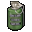
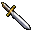
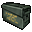
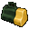
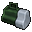
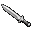

# 일반 아이템

[한국어](08-common-items.md) | [English](08-common-items.en.md) · [Index](README.md)

스포일러 포함. 현재 src/labels.h의 조건별 표식 행이며 고유 아이템 수나 동시 출현 수가 아닙니다. 런타임 추가 판정은 아래 설명과 [데이터와 표 읽기](02-data-pipeline.md)를 참고하세요.

아이템 이름은 영어는 Evil Resource, 한국어는 이 모드의 번역을 따릅니다. 조건이 다른 같은 위치는 행이 나뉩니다.

| Map | Room ID | 방 | 실제 위치 | 아이템 | 아이콘 | x,y | 캐릭터 | 난이도 | 출현 조건 | flag |
| --- | --- | --- | --- | --- | --- | --- | --- | --- | --- | --- |
| 0:2 | 102 | 작은 창고 | — | 섬광 수류탄 |  | 245.1,360.9 | 크리스 | — | — | 76 |
| 0:2 | 102 | 작은 창고 | — | 잉크 리본 |  | 217.74,405.54 | — | — | — | 67 |
| 0:2 | 102 | 작은 창고 | — | 배터리 팩 |  | 245.1,360.9 | 질 | — | — | 66 |
| 0:2 | 103 | 북쪽 복도·다실 | — | 배터리 팩 |  | 286.5,338.4 | 질 | 매우 쉬움·쉬움, 보통 | 조건부 | 32 |
| 0:2 | 103 | 북쪽 복도·다실 | — | 섬광 수류탄 |  | 286.5,338.4 | 크리스 | 매우 쉬움·쉬움, 보통 | 조건부 | 31 |
| 0:2 | 122 | 북쪽 복도·다실 | 103 북쪽 복도·다실 | 방어용 단검 |  | 311.7,411.3 | — | 매우 쉬움·쉬움 | 조건부 | 16 |
| 0:2 | 105 | 식당 | — | 잉크 리본 |  | 384.6,553.5 | — | — | — | 177 |
| 0:2 | 107 | 미술실 | — | 방어용 단검 |  | 672.6,513.9 | — | — | — | 82 |
| 0:2 | 108 | L자 복도 | — | 권총 탄창 |  | 818.4,486.9 | — | 매우 쉬움·쉬움, 보통 | — | 192 |
| 0:2 | 108 | L자 복도 | — | 방어용 단검 |  | 774.3,565.2 | — | — | — | 193 |
| 0:2 | 113 | 욕실 | 109 굽은 복도 | 방어용 단검 |  | 813.9,347.4 | — | — | — | 108 |
| 0:2 | 10b | 묘지 | — | 산탄총 탄약 |  | 465.84,280.16 | — | — | — | 462 |
| 0:3 | 201 | 지하 납골당 | 10b 묘지 | 산탄총 탄약 |  | 603.3,280.8 | — | 매우 쉬움·쉬움, 보통 | 가면 네 개를 모두 끼운 뒤 (뱅크 1 플래그 50–53) | 463 |
| 0:3 | 201 | 지하 납골당 | 10b 묘지 | 권총 탄창 |  | 603.3,280.8 | — | 어려움 | 가면 네 개를 모두 끼운 뒤 (뱅크 1 플래그 50–53) | 463 |
| 0:2 | 10c | 온실 | — | 녹색 약초 |  | 372,407.7 | — | — | 조건부 | 194 |
| 0:2 | 10c | 온실 | — | 녹색 약초 |  | 379.2,407.7 | — | — | 조건부 | 195 |
| 0:2 | 10c | 온실 | — | 녹색 약초 |  | 385.5,408.6 | — | — | 조건부 | 196 |
| 0:2 | 10c | 온실 | — | 녹색 약초 |  | 382.8,412.2 | — | — | 조건부 | 197 |
| 0:2 | 10c | 온실 | — | 녹색 약초 |  | 374.7,412.2 | — | — | 조건부 | 198 |
| 0:2 | 10d | 호랑이 석상실 | — | 산탄총 탄약 |  | 291.9,378.9 | — | — | — | 321 |
| 0:2 | 10e | 연구원 침실 | — | 권총 탄창 |  | 234.3,440.1 | — | — | — | 330 |
| 0:2 | 10e | 연구원 침실 | — | 배터리 팩 |  | 206.4,466.2 | 질 | — | — | 367 |
| 0:2 | 10f | 바 | — | 잉크 리본 |  | 300,454.5 | — | 매우 쉬움·쉬움 | — | 178 |
| 0:2 | 11d | 거울방 | 111 대미술실 ·거울방 | 방어용 단검 |  | 780.6,517.5 | — | — | — | 200 |
| 0:2 | 11d | 거울방 | 111 대미술실 ·거울방 | 녹색 약초 |  | 766.2,517.5 | — | — | — | 202 |
| 0:2 | 111 | 대미술실 ·거울방 | — | 잉크 리본 |  | 601.5,476.1 | — | — | — | 201 |
| 0:2 | 112 | 서쪽 바깥계단 | — | 권총 탄창 |  | 90.3,373.5 | — | 매우 쉬움·쉬움, 보통 | — | 349 |
| 0:2 | 112 | 서쪽 바깥계단 | — | 녹색 약초 |  | 112.8,324 | — | 매우 쉬움·쉬움, 보통 | — | 350 |
| 0:2 | 112 | 서쪽 바깥계단 | — | 녹색 약초 |  | 116.4,324 | — | — | — | 351 |
| 0:2 | 114 | 실외 보일러 | — | 녹색 약초 |  | 808.5,316.8 | — | — | — | 179 |
| 0:2 | 114 | 실외 보일러 | — | 녹색 약초 |  | 819.3,316.8 | — | — | — | 180 |
| 0:2 | 114 | 실외 보일러 | — | 적색 약초 |  | 781.5,308.7 | — | — | — | 181 |
| 0:2 | 114 | 실외 보일러 | — | 적색 약초 |  | 781.5,315.9 | — | 매우 쉬움·쉬움 | — | 182 |
| 0:2 | 114 | 실외 보일러 | — | 적색 약초 |  | 788.7,315.9 | — | 매우 쉬움·쉬움 | — | 183 |
| 0:2 | 116 | 거실 | — | 방어용 단검 |  | 769.8,424.8 | — | — | 조건부 (질) | 209 |
| 0:2 | 116 | 거실 | — | 잉크 리본 |  | 788.7,424.8 | — | 매우 쉬움·쉬움, 보통 | 조건부 (질) | 211 |
| 0:2 | 118 | 동쪽 창고 | — | 권총 탄창 |  | 700.5,345.6 | — | 매우 쉬움·쉬움 | — | 71 |
| 0:2 | 118 | 동쪽 창고 | — | 권총 탄창 |  | 687.9,345.6 | — | 매우 쉬움·쉬움 | 조건부 | 88 |
| 0:2 | 118 | 동쪽 창고 | — | 권총 탄창 |  | 682.5,349.2 | — | 매우 쉬움·쉬움 | 조건부 | 92 |
| 0:2 | 118 | 동쪽 창고 | — | 산탄총 탄약 |  | 682.5,353.7 | 크리스 | 매우 쉬움·쉬움 | 조건부 | 89 |
| 0:2 | 118 | 동쪽 창고 | — | 소이탄 |  | 682.5,353.7 | 질 | 매우 쉬움·쉬움 | 조건부 | 89 |
| 0:2 | 118 | 동쪽 창고 | — | 구급 스프레이 |  | 689.7,353.7 | — | 매우 쉬움·쉬움 | 조건부 | 90 |
| 0:2 | 118 | 동쪽 창고 | — | 구급 스프레이 |  | 689.7,349.2 | — | 매우 쉬움·쉬움 | 조건부 | 93 |
| 0:2 | 118 | 동쪽 창고 | — | 권총 탄창 |  | 682.5,349.2 | 크리스 | 보통 | 조건부 | 92 |
| 0:2 | 118 | 동쪽 창고 | — | 산탄총 탄약 |  | 682.5,353.7 | 크리스 | 보통 | 조건부 | 89 |
| 0:2 | 118 | 동쪽 창고 | — | 소이탄 |  | 682.5,353.7 | 질 | 보통 | 조건부 | 89 |
| 0:2 | 118 | 동쪽 창고 | — | 권총 탄창 |  | 682.5,349.2 | — | 어려움 | 조건부 | 92 |
| 0:2 | 118 | 동쪽 창고 | — | 구급 스프레이 |  | 689.7,353.7 | — | 보통, 어려움 | 조건부 | 90 |
| 0:2 | 119 | 정원 서재 | — | 섬광 수류탄 |  | 624.9,367.2 | 크리스 | — | — | 185 |
| 0:2 | 119 | 정원 서재 | — | 산탄총 탄약 |  | 626.7,346.5 | — | — | — | 184 |
| 0:2 | 119 | 정원 서재 | — | 배터리 팩 |  | 624.9,367.2 | 질 | — | — | 185 |
| 0:2 | 11b | 정원 헛간 | — | 섬광 수류탄 |  | 625.8,226.8 | 크리스 | — | — | 78 |
| 0:2 | 11b | 정원 헛간 | — | 산탄총 탄약 |  | 625.8,187.2 | — | — | — | 79 |
| 0:2 | 11b | 정원 헛간 | — | 구급 스프레이 |  | 645.6,225 | — | — | — | 80 |
| 0:2 | 11b | 정원 헛간 | — | 섬광 수류탄 |  | 633.9,196.2 | 크리스 | 매우 쉬움·쉬움 | 조건부 | 119 |
| 0:2 | 11b | 정원 헛간 | — | 배터리 팩 |  | 633.9,196.2 | 질 | 매우 쉬움·쉬움 | 조건부 | 119 |
| 0:2 | 11b | 정원 헛간 | — | 산탄총 탄약 |  | 618.6,189 | 크리스 | 매우 쉬움·쉬움 | 조건부 | 120 |
| 0:2 | 11b | 정원 헛간 | — | 유산탄 |  | 618.6,189 | 질 | 매우 쉬움·쉬움 | 조건부 | 120 |
| 0:2 | 11b | 정원 헛간 | — | 구급 스프레이 |  | 624.9,195.3 | — | 매우 쉬움·쉬움 | 조건부 | 121 |
| 0:2 | 11b | 정원 헛간 | — | 구급 스프레이 |  | 633.9,189 | — | 매우 쉬움·쉬움 | 조건부 | 122 |
| 0:2 | 11b | 정원 헛간 | — | 섬광 수류탄 |  | 633.9,196.2 | 크리스 | 보통 | 조건부 | 119 |
| 0:2 | 11b | 정원 헛간 | — | 배터리 팩 |  | 633.9,196.2 | 질 | 보통 | 조건부 | 119 |
| 0:2 | 11b | 정원 헛간 | — | 유탄 |  | 618.6,189 | 질 | 보통 | 조건부 | 120 |
| 0:2 | 11b | 정원 헛간 | — | 산탄총 탄약 |  | 618.6,189 | 크리스 | 보통 | 조건부 | 120 |
| 0:2 | 11b | 정원 헛간 | — | 구급 스프레이 |  | 624.9,195.3 | — | 보통 | 조건부 | 121 |
| 0:2 | 11b | 정원 헛간 | — | 방어용 단검 |  | 633.9,196.2 | — | 어려움 | 조건부 | 119 |
| 0:2 | 11b | 정원 헛간 | — | 산탄총 탄약 |  | 618.6,189 | — | 어려움 | 조건부 | 120 |
| 0:2 | 11b | 정원 헛간 | — | 배터리 팩 |  | 625.8,226.8 | 질 | — | — | 103 |
| 0:1 | 202 | 식당 위층 | — | 방어용 단검 |  | 329.7,504 | — | 매우 쉬움·쉬움, 보통 | — | 167 |
| 0:1 | 206 | 작은 서재 | — | 권총 탄창 |  | 639.3,376.2 | — | — | — | 95 |
| 0:2 | 120 | 동쪽 계단 | 207 동쪽 계단 | 녹색 약초 |  | 705,300.6 | — | 매우 쉬움·쉬움 | — | 369 |
| 0:1 | 208 | 사슴 방 | — | 적색 약초 |  | 782.88,343.72 | — | — | — | 361 |
| 0:1 | 208 | 사슴 방 | — | 녹색 약초 |  | 777,343.8 | — | 매우 쉬움·쉬움 | — | 363 |
| 0:1 | 209 | 침실 | — | 구급 상자 |  | 713.1,375.3 | — | 매우 쉬움·쉬움, 보통 | — | 186 |
| 0:1 | 209 | 침실 | — | 잉크 리본 |  | 679.8,342.9 | — | — | — | 187 |
| 0:1 | 209 | 침실 | — | 녹색 약초 |  | 672.6,372.6 | — | — | — | 188 |
| 0:1 | 20b | 휴게실 | — | 녹색 약초 |  | 851.7,396.9 | — | — | — | 331 |
| 0:1 | 20b | 휴게실 | — | 적색 약초 |  | 851.7,391.5 | — | 매우 쉬움·쉬움 | — | 333 |
| 0:1 | 20b | 휴게실 | — | 녹색 약초 |  | 847.2,395.1 | — | 매우 쉬움·쉬움 | — | 370 |
| 0:1 | 20c | 압사 함정실 | — | 방어용 단검 |  | 784.68,494.11 | — | 보통 | — | 33 |
| 0:1 | 20c | 압사 함정실 | — | 배터리 팩 |  | 784.68,494.11 | 질 | 매우 쉬움·쉬움 | — | 33 |
| 0:1 | 20c | 압사 함정실 | — | 섬광 수류탄 |  | 784.68,494.11 | 크리스 | 매우 쉬움·쉬움 | — | 33 |
| 0:1 | 20d | 기둥 방 | — | 녹색 약초 |  | 685.2,568.8 | — | — | — | 217 |
| 0:1 | 20d | 기둥 방 | — | 녹색 약초 |  | 696,569.7 | — | — | — | 218 |
| 0:1 | 20e | 다락 입구 | — | 섬광 수류탄 |  | 779.18,513.02 | 크리스 | 매우 쉬움·쉬움, 보통 | — | 94 |
| 0:1 | 20f | 작은 식당 | — | 권총 탄창 |  | 756.3,568.8 | — | 보통 | — | 98 |
| 0:1 | 20f | 작은 식당 | — | 산탄총 탄약 |  | 756.3,568.8 | — | 매우 쉬움·쉬움 | — | 98 |
| 0:1 | 20f | 작은 식당 | — | 권총 탄창 |  | 738.3,539.1 | — | — | — | 85 |
| 0:1 | 210 | 다락 | — | 산탄총 탄약 |  | 794.1,568.8 | — | 매우 쉬움·쉬움 | — | 20 |
| 0:1 | 210 | 다락 | — | 산탄총 탄약 |  | 794.1,568.8 | — | 매우 쉬움·쉬움, 보통 | — | 20 |
| 0:1 | 212 | 야외 테라스 | — | 방어용 단검 |  | 794.1,609.3 | — | — | — | 328 |
| 0:1 | 212 | 야외 테라스 | — | 녹색 약초 |  | 865.2,506.7 | — | 매우 쉬움·쉬움, 보통 | — | 326 |
| 0:1 | 212 | 야외 테라스 | — | 녹색 약초 |  | 872.4,506.7 | — | 매우 쉬움·쉬움, 보통 | — | 327 |
| 0:1 | 212 | 야외 테라스 | — | 권총 탄창 |  | 629.4,582.3 | — | 매우 쉬움·쉬움 | — | 371 |
| 0:1 | 213 | 승강기 복도 | — | 녹색 약초 |  | 395.4,448.2 | — | — | — | 35 |
| 0:1 | 213 | 승강기 복도 | — | 녹색 약초 |  | 395.4,438.3 | — | — | — | 37 |
| 0:1 | 213 | 승강기 복도 | — | 적색 약초 |  | 409.8,437.4 | — | 매우 쉬움·쉬움, 보통 | — | 36 |
| 0:1 | 214 | 거울 복도 | — | 권총 탄창 |  | 241.5,467.1 | — | — | — | 99 |
| 0:1 | 214 | 거울 복도 | — | 녹색 약초 |  | 214.5,299.7 | — | — | — | 84 |
| 0:1 | 214 | 거울 복도 | — | 녹색 약초 |  | 208.2,299.7 | — | 매우 쉬움·쉬움 | — | 115 |
| 0:1 | 215 | 박제실 | — | 산탄총 탄약 |  | 183,411.3 | 크리스 | 매우 쉬움·쉬움, 보통 | 조건부 | 191 |
| 0:1 | 215 | 박제실 | — | 권총 탄창 |  | 183,411.3 | — | 어려움 | 조건부 | 191 |
| 0:1 | 215 | 박제실 | — | 방어용 단검 |  | 163.2,347.4 | — | — | 조건부 | 190 |
| 0:1 | 215 | 박제실 | — | 유탄 |  | 183,411.3 | 질 | 매우 쉬움·쉬움, 보통 | 조건부 | 191 |
| 0:1 | 219 | 자재실 | — | 섬광 수류탄 |  | 327.9,496.8 | 크리스 | — | — | 29 |
| 0:1 | 219 | 자재실 | — | 산탄총 탄약 |  | 345.9,481.5 | 크리스 | — | — | 27 |
| 0:1 | 219 | 자재실 | — | 매그넘 탄약 |  | 350.4,481.5 | 크리스 | 매우 쉬움·쉬움, 어려움 | — | 28 |
| 0:1 | 219 | 자재실 | — | 산탄총 탄약 |  | 350.4,481.5 | 크리스 | 보통 | — | 28 |
| 0:1 | 219 | 자재실 | — | 배터리 팩 |  | 327.9,496.8 | 질 | — | — | 26 |
| 0:1 | 219 | 자재실 | — | 유산탄 |  | 345.9,481.5 | 질 | 매우 쉬움·쉬움 | — | 24 |
| 0:1 | 219 | 자재실 | — | 산탄총 탄약 |  | 345.9,481.5 | 질 | 보통, 어려움 | — | 24 |
| 0:1 | 219 | 자재실 | — | 매그넘 탄약 |  | 350.4,481.5 | 질 | 매우 쉬움·쉬움, 어려움 | — | 25 |
| 0:1 | 219 | 자재실 | — | 유산탄 |  | 350.4,481.5 | 질 | 보통 | — | 25 |
| 0:3 | 21a | 콘크리트 통로 1 | — | 산탄총 탄약 |  | 525,495.9 | — | — | — | 220 |
| 0:3 | 21b | 콘크리트 통로 2 | — | 적색 약초 |  | 444.9,571.5 | — | 매우 쉬움·쉬움, 보통 | — | 101 |
| 0:3 | 21b | 콘크리트 통로 2 | — | 청색 약초 |  | 445.8,565.2 | — | — | — | 102 |
| 0:3 | 21b | 콘크리트 통로 2 | — | 권총 탄창 |  | 322.5,525.6 | — | 매우 쉬움·쉬움, 보통 | — | 86 |
| 0:3 | 21b | 콘크리트 통로 2 | — | 방어용 단검 |  | 454.81,530.69 | — | — | — | 87 |
| 0:3 | 21c | 주방 | — | 방어용 단검 |  | 334.2,498.6 | — | 매우 쉬움·쉬움, 보통 | — | 83 |
| 0:3 | 21c | 주방 | — | 권총 탄창 |  | 363.9,497.7 | — | 매우 쉬움·쉬움 | — | 97 |
| 1:2 | 302 | 폭포 | — | 녹색 약초 |  | 317.1,541.8 | — | 매우 쉬움·쉬움 | — | 245 |
| 1:2 | 304 | 지그재그 길 | — | 적색 약초 |  | 241.5,518.4 | — | 매우 쉬움·쉬움, 보통 | — | 166 |
| 1:3 | 307 | 지하 입구 통로 | — | 잉크 리본 |  | 452.1,278.1 | — | — | — | 125 |
| 1:3 | 307 | 지하 입구 통로 | — | 녹색 약초 |  | 410.7,387.9 | — | — | — | 116 |
| 1:3 | 307 | 지하 입구 통로 | — | 청색 약초 |  | 480.9,338.4 | — | 매우 쉬움·쉬움 | — | 126 |
| 1:3 | 308 | 갈림길 | — | 산탄총 탄약 |  | 579.9,445.5 | 크리스 | 매우 쉬움·쉬움 | — | 221 |
| 1:3 | 308 | 갈림길 | — | 유산탄 |  | 579.9,445.5 | 질 | 매우 쉬움·쉬움 | — | 221 |
| 1:3 | 30b | 바위 통로 1 | — | 산탄총 탄약 |  | 273.9,470.7 | — | 매우 쉬움·쉬움, 보통 | — | 168 |
| 1:3 | 30b | 바위 통로 1 | — | 권총 탄창 |  | 274.8,470.7 | — | 어려움 | — | 168 |
| 1:3 | 30c | 거미 방 | — | 생존용 단검 |  | 399,511.2 | — | — | — | 387 |
| 1:3 | 30d | 직선 통로 | — | 청색 약초 |  | 510.6,598.5 | — | 매우 쉬움·쉬움, 보통 | — | 163 |
| 1:3 | 30d | 직선 통로 | — | 청색 약초 |  | 514.2,588.6 | — | — | — | 164 |
| 1:3 | 30d | 직선 통로 | — | 녹색 약초 |  | 503.4,597.6 | — | 매우 쉬움·쉬움 | — | 165 |
| 1:3 | 30f | 바위 통로 2 | — | 구급 상자 |  | 147,551.7 | — | — | — | 169 |
| 1:2 | 313 | 숲길 | — | 녹색 약초 |  | 635.45,273.3 | — | 매우 쉬움·쉬움 | — | 222 |
| 1:2 | 313 | 숲길 | — | 녹색 약초 |  | 635.45,268.24 | — | 매우 쉬움·쉬움 | — | 223 |
| 1:4 | 317 | 굽은 지하 통로 | — | 녹색 약초 |  | 513.3,430.2 | — | — | — | 259 |
| 1:4 | 317 | 굽은 지하 통로 | — | 녹색 약초 |  | 518.7,430.2 | — | 어려움 | — | 261 |
| 1:4 | 317 | 굽은 지하 통로 | — | 적색 약초 |  | 520.5,430.2 | — | 매우 쉬움·쉬움, 보통 | — | 260 |
| 1:4 | 318 | 지하 창고 | — | 매그넘 탄약 |  | 678.9,459.9 | — | 매우 쉬움·쉬움, 보통 | — | 376 |
| 1:4 | 318 | 지하 창고 | — | 권총 탄창 |  | 679.8,460.8 | — | — | — | 375 |
| 1:4 | 318 | 지하 창고 | — | 섬광 수류탄 |  | 678,462.6 | 크리스 | — | — | 377 |
| 1:4 | 318 | 지하 창고 | — | 배터리 팩 |  | 678,462.6 | 질 | — | — | 378 |
| 1:4 | 31d | 리사의 방 | 319 리사의 방 | 녹색 약초 |  | 596.1,281.7 | — | — | — | 402 |
| 1:4 | 31d | 리사의 방 | 319 리사의 방 | 청색 약초 |  | 598.8,271.8 | — | — | — | 403 |
| 1:4 | 31d | 리사의 방 | 319 리사의 방 | 방어용 단검 |  | 517.8,296.1 | — | 매우 쉬움·쉬움 | — | 404 |
| 2:2 | 400 | 입구 복도 | — | 청색 약초 |  | 144.3,423 | — | 매우 쉬움·쉬움, 보통 | — | 225 |
| 2:2 | 400 | 입구 복도 | — | 청색 약초 |  | 144.3,433.8 | — | — | — | 226 |
| 2:2 | 400 | 입구 복도 | — | 청색 약초 |  | 144.3,443.7 | — | 매우 쉬움·쉬움, 보통 | — | 227 |
| 2:2 | 401 | 001호실 | — | 권총 탄창 |  | 236.1,379.8 | — | 매우 쉬움·쉬움, 보통 | — | 256 |
| 2:2 | 401 | 001호실 | — | 권총 탄창 |  | 247.78,373.63 | — | 매우 쉬움·쉬움 | — | 257 |
| 2:2 | 403 | 창고 | — | 섬광 수류탄 |  | 183.9,498.6 | 크리스 | — | — | 228 |
| 2:2 | 403 | 창고 | — | 잉크 리본 |  | 183,505.8 | — | — | — | 229 |
| 2:2 | 403 | 창고 | — | 구급 스프레이 |  | 200.1,486 | — | 매우 쉬움·쉬움 | — | 230 |
| 2:2 | 403 | 창고 | — | 배터리 팩 |  | 183.9,498.6 | 질 | — | — | 228 |
| 2:2 | 404 | 오락실 | — | 녹색 약초 |  | 312.6,495.9 | — | — | — | 231 |
| 2:2 | 404 | 오락실 | — | 녹색 약초 |  | 354.9,419.4 | — | 매우 쉬움·쉬움, 보통 | — | 232 |
| 2:2 | 404 | 오락실 | — | 구급 상자 |  | 363.9,321.3 | — | — | — | 233 |
| 2:2 | 404 | 오락실 | — | 산탄총 탄약 |  | 326.1,355.5 | — | 매우 쉬움·쉬움, 보통 | — | 234 |
| 2:2 | 408 | 미술관 | — | 적색 약초 |  | 449.4,343.8 | — | 매우 쉬움·쉬움 | — | 380 |
| 2:2 | 408 | 미술관 | — | 적색 약초 |  | 676.73,538.15 | — | — | — | 379 |
| 2:2 | 408 | 미술관 | — | 권총 탄창 |  | 534,502.2 | — | — | — | 381 |
| 2:2 | 40a | 003호실 | — | 잉크 리본 |  | 592.5,498.6 | — | 매우 쉬움·쉬움 | 조건부 | 170 |
| 2:2 | 40b | 003호 욕실 | — | 방어용 단검 |  | 598.8,443.7 | — | 매우 쉬움·쉬움 | — | 353 |
| 2:3 | 40d | 대형 수조 입구 | — | 녹색 약초 |  | 556.5,257.4 | — | — | — | 389 |
| 2:4 | 415 | 대형 수조 입구 | 40d 대형 수조 입구 | 매그넘 탄약 |  | 340.5,305.1 | — | 매우 쉬움·쉬움, 보통 | — | 390 |
| 2:4 | 410 | 대형 수조 창고 | — | 산탄총 탄약 |  | 461.1,441.9 | — | 매우 쉬움·쉬움 | — | 382 |
| 2:4 | 410 | 대형 수조 창고 | — | 산탄총 탄약 |  | 440.4,450 | — | 매우 쉬움·쉬움 | — | 358 |
| 2:4 | 410 | 대형 수조 창고 | — | 매그넘 탄약 |  | 487.2,396.9 | — | 어려움 | — | 359 |
| 2:4 | 410 | 대형 수조 창고 | — | 산탄총 탄약 |  | 440.4,450 | — | 보통 | — | 358 |
| 2:4 | 410 | 대형 수조 창고 | — | 유탄 |  | 461.1,441.9 | — | 매우 쉬움·쉬움 | — | 383 |
| 2:4 | 411 | 제어실 | — | 구급 상자 |  | 431.4,556.2 | — | 매우 쉬움·쉬움, 보통 | — | 249 |
| 4:3 | 501 | 헬기장 통로 | — | 구급 상자 |  | 507,448.2 | — | — | — | 243 |
| 4:3 | 501 | 헬기장 통로 | — | 구급 상자 |  | 510.6,462.6 | — | 매우 쉬움·쉬움 | — | 244 |
| 4:3 | 501 | 헬기장 통로 | — | 산탄총 탄약 |  | 522.3,462.6 | — | 매우 쉬움·쉬움, 보통 | — | 242 |
| 4:4 | 502 | 아이템 상자실 | — | 잉크 리본 |  | 645.6,388.8 | — | — | — | 258 |
| 4:4 | 503 | 계단 | — | 녹색 약초 |  | 409.8,396 | — | — | — | 395 |
| 4:4 | 503 | 계단 | — | 녹색 약초 |  | 429.6,445.5 | — | 매우 쉬움·쉬움, 보통 | — | 396 |
| 4:4 | 503 | 계단 | — | 녹색 약초 |  | 410.7,411.3 | — | 매우 쉬움·쉬움 | — | 397 |
| 4:4 | 504 | 영상 자료실 | — | 구급 스프레이 |  | 346.8,374.4 | — | 매우 쉬움·쉬움, 보통 | — | 117 |
| 4:4 | 504 | 영상 자료실 | — | 산탄총 탄약 |  | 258.6,396.9 | — | 매우 쉬움·쉬움, 보통 | — | 408 |
| 4:5 | 505 | O자 통로 | — | 방어용 단검 |  | 477.3,379.8 | — | — | — | 118 |
| 4:5 | 505 | O자 통로 | — | 권총 탄창 |  | 492.6,381.6 | — | 매우 쉬움·쉬움 | — | 409 |
| 4:5 | 506 | 수술실 | — | 섬광 수류탄 |  | 498.9,316.8 | 크리스 | — | — | 171 |
| 4:5 | 506 | 수술실 | — | 매그넘 탄약 |  | 525.9,287.1 | — | 매우 쉬움·쉬움, 보통 | — | 172 |
| 4:5 | 506 | 수술실 | — | 구급 상자 |  | 487.2,318.6 | — | 매우 쉬움·쉬움, 보통 | — | 162 |
| 4:5 | 506 | 수술실 | — | 배터리 팩 |  | 498.9,316.8 | 질 | — | — | 171 |
| 4:5 | 507 | 시체 안치실 | — | 섬광 수류탄 |  | 473.7,370.8 | 크리스 | 매우 쉬움·쉬움, 보통 | — | 236 |
| 4:5 | 507 | 시체 안치실 | — | 배터리 팩 |  | 473.7,370.8 | 질 | 매우 쉬움·쉬움, 보통 | — | 236 |
| 4:5 | 507 | 시체 안치실 | — | 산탄총 탄약 |  | 499.8,343.8 | — | — | — | 251 |
| 4:5 | 508 | 암호 복도 | — | 구급 상자 |  | 428.7,326.7 | — | 어려움 | — | 127 |
| 4:5 | 508 | 암호 복도 | — | 구급 상자 |  | 428.7,326.7 | — | 매우 쉬움·쉬움, 보통 | — | 127 |
| 4:5 | 50a | X선실 B | — | 잉크 리본 |  | 420.6,316.8 | — | 매우 쉬움·쉬움 | — | 173 |
| 4:5 | 50a | X선실 B | — | 소이탄 |  | 403.5,309.6 | 질 | 매우 쉬움·쉬움, 보통 | — | 174 |
| 4:5 | 50a | X선실 B | — | 매그넘 탄약 |  | 403.5,309.6 | 크리스 | 매우 쉬움·쉬움, 보통 | — | 174 |
| 4:5 | 50a | X선실 B | — | 권총 탄창 |  | 403.5,309.6 | — | 어려움 | — | 174 |
| 4:5 | 50e | 휴게실 | — | 산탄총 탄약 |  | 618.6,377.1 | 질 | 매우 쉬움·쉬움 | — | 238 |
| 4:5 | 50e | 휴게실 | — | 유탄 |  | 618.6,386.1 | 질 | 매우 쉬움·쉬움, 보통 | — | 237 |
| 4:5 | 50e | 휴게실 | — | 소이탄 |  | 618.6,386.1 | 질 | 어려움 | — | 237 |
| 4:5 | 50e | 휴게실 | — | 매그넘 탄약 |  | 618.6,377.1 | 크리스 | 매우 쉬움·쉬움 | — | 238 |
| 4:5 | 50e | 휴게실 | — | 산탄총 탄약 |  | 618.6,386.1 | 크리스 | — | — | 237 |
| 4:5 | 50e | 휴게실 | — | 잉크 리본 |  | 627.6,382.5 | — | — | — | 239 |
| 4:5 | 50e | 휴게실 | — | 구급 스프레이 |  | 624.9,387 | — | — | — | 240 |
| 4:5 | 510 | 동력 미로 B | — | 섬광 수류탄 |  | 559.2,548.1 | 크리스 | — | — | 175 |
| 4:5 | 510 | 동력 미로 B | — | 배터리 팩 |  | 559.2,548.1 | 질 | — | — | 175 |
| 4:5 | 512 | 감방 | — | 산탄총 탄약 |  | 407.1,273.6 | — | 매우 쉬움·쉬움, 보통 | — | 252 |
| 4:5 | 512 | 감방 | — | 산탄총 탄약 |  | 407.1,273.6 | 크리스 | 어려움 | — | 252 |
| 4:5 | 512 | 감방 | — | 소이탄 |  | 407.1,273.6 | 질 | 어려움 | — | 252 |
| 4:6 | 514 | 중앙 연구실 입구 | — | 산탄총 탄약 |  | 488.1,287.1 | — | 매우 쉬움·쉬움 | — | 410 |
| 4:6 | 514 | 중앙 연구실 입구 | — | 산탄총 탄약 |  | 480.9,287.1 | — | 매우 쉬움·쉬움, 보통 | — | 411 |
| 1:2 | 300 | 중앙 정원 | — | 청색 약초 |  | 493.5,567.9 | — | 매우 쉬움·쉬움, 보통 | — | 348 |
| 1:2 | 300 | 중앙 정원 | — | 녹색 약초 |  | 493.5,572.4 | — | 매우 쉬움·쉬움, 보통 | — | 346 |
| 1:3 | 309 | 발전기실 | — | 권총 탄창 |  | 720.3,453.6 | — | 매우 쉬움·쉬움, 보통 | — | 373 |
| 1:3 | 309 | 발전기실 | — | 권총 탄창 |  | 637.8,336.18 | — | — | — | 332 |
| 1:3 | 309 | 발전기실 | — | 녹색 약초 |  | 659.73,336.18 | — | 매우 쉬움·쉬움 | — | 372 |
| 1:4 | 316 | 쓰레기 압축실 | — | 권총 탄창 |  | 298.27,633.6 | — | 매우 쉬움·쉬움 | — | 374 |
