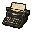
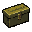

# Typewriters and item boxes

[한국어](09-save-points.md) | [English](09-save-points.en.md) · [Index](README.en.md)

Spoilers.

 

At normal scale the game's own callouts are used. While the map is zoomed 2x they are hidden, so icons are drawn in the middle of each visited room. That is the room's middle, not the machine's exact spot. Key `0` hides them too.

| Room ID | Room | Typewriter | Item box |
| --- | --- | --- | --- |
| 100 Medical Storage Room | Medical Storage Room | ○ | ○ |
| 105 Dining Room | Dining Room | ○ | — |
| 118 East Wing Storeroom | East Wing Storeroom | ○ | ○ |
| 307 Entrance Passage | Entrance Passage | ○ | ○ |
| 314 Cabin | Cabin | ○ | ○ |
| 316 Garbage Compactor Room | Garbage Compactor Room | — | ○ |
| 31a Stairway Passage | Stairway Passage | ○ | ○ |
| 31f Cabin | Cabin | ○ | ○ |
| 403 Storeroom | Storeroom | ○ | ○ |
| 40a Room 003 | Room 003 | ○ | — |
| 502 Item Box Room | Item Box Room | ○ | ○ |
| 50e Lounge Room | Lounge Room | ○ | ○ |
