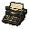
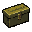

# 타자기와 아이템 상자

[한국어](09-save-points.md) | [English](09-save-points.en.md) · [Index](README.md)

스포일러 포함.

 

기본 배율에서는 게임 자체의 안내 표시를 그대로 사용합니다. 2배 확대 중에는 그 안내가 숨겨지므로 방문한 방의 가운데에 아이콘을 대신 그립니다. 기계의 실제 위치가 아니라 방의 가운데입니다. 키 `0`으로 함께 꺼집니다.

| Room ID | 방 | 타자기 | 아이템 상자 |
| --- | --- | --- | --- |
| 100 의약품 창고 | 의약품 창고 | ○ | ○ |
| 105 식당 | 식당 | ○ | — |
| 118 동쪽 창고 | 동쪽 창고 | ○ | ○ |
| 307 지하 입구 통로 | 지하 입구 통로 | ○ | ○ |
| 314 산장 | 산장 | ○ | ○ |
| 316 쓰레기 압축실 | 쓰레기 압축실 | — | ○ |
| 31a 제단 계단 통로 | 제단 계단 통로 | ○ | ○ |
| 31f 산장 | 산장 | ○ | ○ |
| 403 창고 | 창고 | ○ | ○ |
| 40a 003호실 | 003호실 | ○ | — |
| 502 아이템 상자실 | 아이템 상자실 | ○ | ○ |
| 50e 휴게실 | 휴게실 | ○ | ○ |
