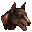
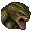

# Enemies

[한국어](11-enemies.md) | [English](11-enemies.en.md) · [Index](README.en.md)

Spoilers.

The repository has no table of enemy positions. While you play, the mod records the enemies the game actually spawns in each room, and key `7` shows those records.

- Enemies appear only in rooms visited in the loaded save, and only for the same character and difficulty class. Rooms you never entered show none.
- Defeated enemies disappear. Loading a room again rewrites its records.
- If an older save moves the game clock back, records made after that point are removed.
- Records are stored in `RE1HD.AnnotatedMap.enemies.dat`. Nothing is written to game memory or saves.

Crimson Heads show an icon where the enemy fell. It is grey before the revival event and while the timer is running. Hold `7` while enemies are on to switch the minutes left on or off.

## Enemy types

`Type` is the game's enemy type number, and `enemy_icon_of_em` gives its icon. Numbers not listed are not drawn.

| Enemy | Icon | Type |
| --- | --- | --- |
| Adder |  | 11 |
| Cerberus |  | 9 |
| Chimera |  | 16 |
| Crow |  | 10 |
| Hunter |  | 15 |
| Lisa Trevor |  | 19 |
| Neptune |  | 27–28 |
| Plant 42 |  | 17 |
| Tyrant |  | 49 |
| Wasp |  | 12 |
| Web Spinner |  | 24 |
| Yawn |  | 26 |
| Zombie |  | 20–23, 31–42 |
| Crimson Head |  | — |

## Crimson Head fallback table

For an enemy defeated before recording began, this table decides the room. It maps enemy numbers to rooms; it holds neither enemy coordinates nor appearance conditions.

| Map | Room | Second room | Count | Enemy numbers |
| --- | --- | --- | --- | --- |
| 0:2 | 101 West Wing Inner Stairway | — | 5 | 385–389 |
| 0:2 | 101 West Wing Inner Stairway | 203 Outside Balcony | 1 | 384 |
| 0:2 | 103 Northern Corridor | — | 5 | 16–19, 32 |
| 0:2 | 106 Main Hall | — | 1 | 29 |
| 0:2 | 107 Art Room | — | 1 | 140 |
| 0:2 | 108 'L' Corridor | — | 2 | 390–391 |
| 0:2 | 109 Winding Corridor | — | 7 | 128–133, 144 |
| 0:2 | 10a Dark Corridor | — | 1 | 528 |
| 0:2 | 10b Graveyard | — | 3 | 164–166 |
| 0:2 | 10d Tiger Statue Room | — | 25 | 534–558 |
| 0:2 | 10e Researcher's Bedroom | — | 2 | 519–520 |
| 0:2 | 111 Large Art & Mirror Rooms | — | 2 | 393–394 |
| 0:2 | 112 West Wing Outer Stairway | — | 8 | 576–582, 585 |
| 0:2 | 114 Outside Boiler | — | 2 | 256–257 |
| 0:2 | 114 Outside Boiler | 203 Outside Balcony | 1 | 395 |
| 0:2 | 117 Large Gallery | — | 6 | 512–517 |
| 0:2 | 11a Roofed Passage | — | 1 | 583 |
| 0:1 | 202 Dining Room | — | 4 | 258–261 |
| 0:1 | 203 Outside Balcony | — | 3 | 396–398 |
| 0:1 | 204 'C' Corridor | — | 4 | 22–25 |
| 0:1 | 204 'C' Corridor | 207 East Wing Stairway | 1 | 523 |
| 0:1 | 204 'C' Corridor | 20d Pillar Room | 1 | 20 |
| 0:1 | 206 Small Library | — | 1 | 145 |
| 0:1 | 207 East Wing Stairway | — | 3 | 522, 526–527 |
| 0:1 | 207 East Wing Stairway | 208 Deer Room | 1 | 524 |
| 0:1 | 20a Fish Tank Room | — | 1 | 262 |
| 0:1 | 20e Attic Entry | 20f Small Dining Room | 1 | 134 |
| 0:1 | 20f Small Dining Room | — | 1 | 135 |
| 0:1 | 210 Attic | — | 1 | 30 |
| 0:1 | 212 Outside Patio | — | 1 | 518 |
| 0:1 | 213 Elevator Corridor | — | 3 | 26–28 |
| 0:1 | 214 Mirror Corridor | — | 3 | 136–137, 175 |
| 0:1 | 215 Trophy Room | — | 1 | 584 |
| 0:3 | 21a Concrete Passage 1 | — | 3 | 399–401 |
| 0:3 | 21b Concrete Passage 2 | — | 3 | 141–143 |
| 0:3 | 21c Kitchen | — | 4 | 138–139, 146–147 |
| 1:2 | 300 Main Garden | — | 3 | 531–533 |
| 1:2 | 301 Water Pool | — | 10 | 153–162 |
| 1:2 | 302 Falls Area | — | 7 | 402–408 |
| 4:2 | 303 Heliport | — | 4 | 1–4 |
| 1:2 | 304 Zigzag Path | — | 2 | 264–265 |
| 1:3 | 308 Forked Passage | — | 2 | 417, 428 |
| 1:3 | 30a Enrico Room | — | 1 | 409 |
| 1:3 | 30b Boulder Passage 1 | — | 1 | 263 |
| 1:3 | 30c Spider Room | — | 9 | 648–656 |
| 1:2 | 312 Small Headstone Area | — | 8 | 167–174 |
| 1:2 | 313 Forest Pathway | — | 1 | 429 |
| 1:2 | 314 Cabin | — | 1 | 410 |
| 3:4 | 315 Jessica's Tomb | — | 1 | 176 |
| 2:2 | 400 Entry Corridor | — | 1 | 412 |
| 2:2 | 401 Room 001 | — | 1 | 529 |
| 2:2 | 402 Room 001 Bathroom | — | 1 | 530 |
| 2:2 | 404 Rec Room | — | 2 | 413–414 |
| 2:2 | 405 Central Corridor | — | 3 | 586–588 |
| 2:2 | 406 Room 002 | 407 Room 002 Bathroom | 1 | 575 |
| 2:2 | 40c Plant 42 Room | — | 1 | 163 |
| 2:3 | 40e Aqua Ring Walkway | — | 3 | 644–645, 647 |
| 2:3 | 40e Aqua Ring Walkway | 412 Aqua Ring Water Tank | 1 | 646 |
| 2:3 | 40f Guard Room | — | 1 | 416 |
| 2:4 | 411 Control Room | — | 1 | 415 |
| 2:4 | 412 Aqua Ring Water Tank | — | 1 | 640 |
| 4:5 | 505 'O' Room | — | 5 | 148–152 |
| 4:5 | 507 Morgue | — | 2 | 420–421 |
| 4:5 | 50a X-Ray Room B | — | 2 | 426–427 |
| 4:5 | 50c Elevator Entry | — | 2 | 418–419 |
| 4:5 | 50f Power Maze A | — | 3 | 181–183 |
| 4:5 | 510 Power Maze B | — | 4 | 422–425 |
| 4:5 | 511 Power Control Room | — | 4 | 177–180 |
| 4:6 | 513 Main Laboratory | — | 1 | 657 |
