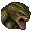

# 적

[한국어](11-enemies.md) | [English](11-enemies.en.md) · [Index](README.md)

스포일러 포함.

적 위치는 저장소에 표로 들어 있지 않습니다. 모드는 플레이 중 게임이 실제로 만든 적을 방마다 기록하고, 키 `7`을 켜면 그 기록을 표시합니다.

- 불러온 세이브에서 방문한 방의 적만, 같은 캐릭터·같은 난이도 분류일 때 표시합니다. 들어가지 않은 방에는 표시되지 않습니다.
- 쓰러뜨린 적은 사라집니다. 방을 다시 불러오면 그 방의 기록을 새로 씁니다.
- 더 오래된 세이브를 불러와 게임 시계가 되돌아가면 그 시점 이후의 기록을 지웁니다.
- 기록은 `RE1HD.AnnotatedMap.enemies.dat`에 저장합니다. 게임 메모리나 세이브에는 쓰지 않습니다.

크림슨 헤드는 쓰러진 자리에 아이콘을 표시하며, 부활 이벤트 전이나 타이머가 남아 있으면 회색입니다. 적 표시 중 `7`을 길게 누르면 남은 분을 켜고 끕니다.

## 적 종류

`유형`은 게임의 적 유형 번호이며 각 번호의 아이콘은 `enemy_icon_of_em`에서 나옵니다. 표에 없는 번호는 그리지 않습니다.

| 적 | 아이콘 | 유형 |
| --- | --- | --- |
| 독사 |  | 11 |
| 케르베로스 |  | 9 |
| 키메라 |  | 16 |
| 까마귀 |  | 10 |
| 헌터 |  | 15 |
| 리사 트레버 |  | 19 |
| 넵튠 |  | 27–28 |
| 플랜트 42 |  | 17 |
| 타이런트 |  | 49 |
| 말벌 |  | 12 |
| 웹 스피너 |  | 24 |
| 요운 |  | 26 |
| 좀비 |  | 20–23, 31–42 |
| 크림슨 헤드 |  | — |

## 크림슨 헤드 대체 표

기록이 시작되기 전에 쓰러진 적은 이 표로 방을 정합니다. 적의 좌표나 출현 조건이 아니라 적 번호와 방의 대응입니다.

| Map | 방 | 두 번째 방 | 수 | 적 번호 |
| --- | --- | --- | --- | --- |
| 0:2 | 101 서쪽 안계단 | — | 5 | 385–389 |
| 0:2 | 101 서쪽 안계단 | 203 발코니 | 1 | 384 |
| 0:2 | 103 북쪽 복도 | — | 5 | 16–19, 32 |
| 0:2 | 106 중앙 홀 | — | 1 | 29 |
| 0:2 | 107 미술실 | — | 1 | 140 |
| 0:2 | 108 L자 복도 | — | 2 | 390–391 |
| 0:2 | 109 굽은 복도 | — | 7 | 128–133, 144 |
| 0:2 | 10a 어두운 복도 | — | 1 | 528 |
| 0:2 | 10b 묘지 | — | 3 | 164–166 |
| 0:2 | 10d 호랑이 석상실 | — | 25 | 534–558 |
| 0:2 | 10e 연구원 침실 | — | 2 | 519–520 |
| 0:2 | 111 대미술실 ·거울방 | — | 2 | 393–394 |
| 0:2 | 112 서쪽 바깥계단 | — | 8 | 576–582, 585 |
| 0:2 | 114 실외 보일러 | — | 2 | 256–257 |
| 0:2 | 114 실외 보일러 | 203 발코니 | 1 | 395 |
| 0:2 | 117 대미술관 | — | 6 | 512–517 |
| 0:2 | 11a 지붕 통로 | — | 1 | 583 |
| 0:1 | 202 식당 위층 | — | 4 | 258–261 |
| 0:1 | 203 발코니 | — | 3 | 396–398 |
| 0:1 | 204 C자 복도 | — | 4 | 22–25 |
| 0:1 | 204 C자 복도 | 207 동쪽 계단 | 1 | 523 |
| 0:1 | 204 C자 복도 | 20d 기둥 방 | 1 | 20 |
| 0:1 | 206 작은 서재 | — | 1 | 145 |
| 0:1 | 207 동쪽 계단 | — | 3 | 522, 526–527 |
| 0:1 | 207 동쪽 계단 | 208 사슴 방 | 1 | 524 |
| 0:1 | 20a 어항실 | — | 1 | 262 |
| 0:1 | 20e 다락 입구 | 20f 작은 식당 | 1 | 134 |
| 0:1 | 20f 작은 식당 | — | 1 | 135 |
| 0:1 | 210 다락 | — | 1 | 30 |
| 0:1 | 212 야외 테라스 | — | 1 | 518 |
| 0:1 | 213 승강기 복도 | — | 3 | 26–28 |
| 0:1 | 214 거울 복도 | — | 3 | 136–137, 175 |
| 0:1 | 215 박제실 | — | 1 | 584 |
| 0:3 | 21a 콘크리트 통로 1 | — | 3 | 399–401 |
| 0:3 | 21b 콘크리트 통로 2 | — | 3 | 141–143 |
| 0:3 | 21c 주방 | — | 4 | 138–139, 146–147 |
| 1:2 | 300 중앙 정원 | — | 3 | 531–533 |
| 1:2 | 301 연못 | — | 10 | 153–162 |
| 1:2 | 302 폭포 | — | 7 | 402–408 |
| 4:2 | 303 헬기장 | — | 4 | 1–4 |
| 1:2 | 304 지그재그 길 | — | 2 | 264–265 |
| 1:3 | 308 갈림길 | — | 2 | 417, 428 |
| 1:3 | 30a 엔리코의 방 | — | 1 | 409 |
| 1:3 | 30b 바위 통로 1 | — | 1 | 263 |
| 1:3 | 30c 거미 방 | — | 9 | 648–656 |
| 1:2 | 312 작은 묘비 | — | 8 | 167–174 |
| 1:2 | 313 숲길 | — | 1 | 429 |
| 1:2 | 314 산장 | — | 1 | 410 |
| 3:4 | 315 제시카의 무덤 | — | 1 | 176 |
| 2:2 | 400 입구 복도 | — | 1 | 412 |
| 2:2 | 401 001호실 | — | 1 | 529 |
| 2:2 | 402 001호 욕실 | — | 1 | 530 |
| 2:2 | 404 오락실 | — | 2 | 413–414 |
| 2:2 | 405 중앙 복도 | — | 3 | 586–588 |
| 2:2 | 406 002호실 | 407 002호 욕실 | 1 | 575 |
| 2:2 | 40c 식물 42 방 | — | 1 | 163 |
| 2:3 | 40e 대형 수조 통로 | — | 3 | 644–645, 647 |
| 2:3 | 40e 대형 수조 통로 | 412 대형 수조 | 1 | 646 |
| 2:3 | 40f 경비실 | — | 1 | 416 |
| 2:4 | 411 제어실 | — | 1 | 415 |
| 2:4 | 412 대형 수조 | — | 1 | 640 |
| 4:5 | 505 O자 통로 | — | 5 | 148–152 |
| 4:5 | 507 시체 안치실 | — | 2 | 420–421 |
| 4:5 | 50a X선실 B | — | 2 | 426–427 |
| 4:5 | 50c 승강기 입구 | — | 2 | 418–419 |
| 4:5 | 50f 동력 미로 A | — | 3 | 181–183 |
| 4:5 | 510 동력 미로 B | — | 4 | 422–425 |
| 4:5 | 511 동력 제어실 | — | 4 | 177–180 |
| 4:6 | 513 중앙 연구실 | — | 1 | 657 |
